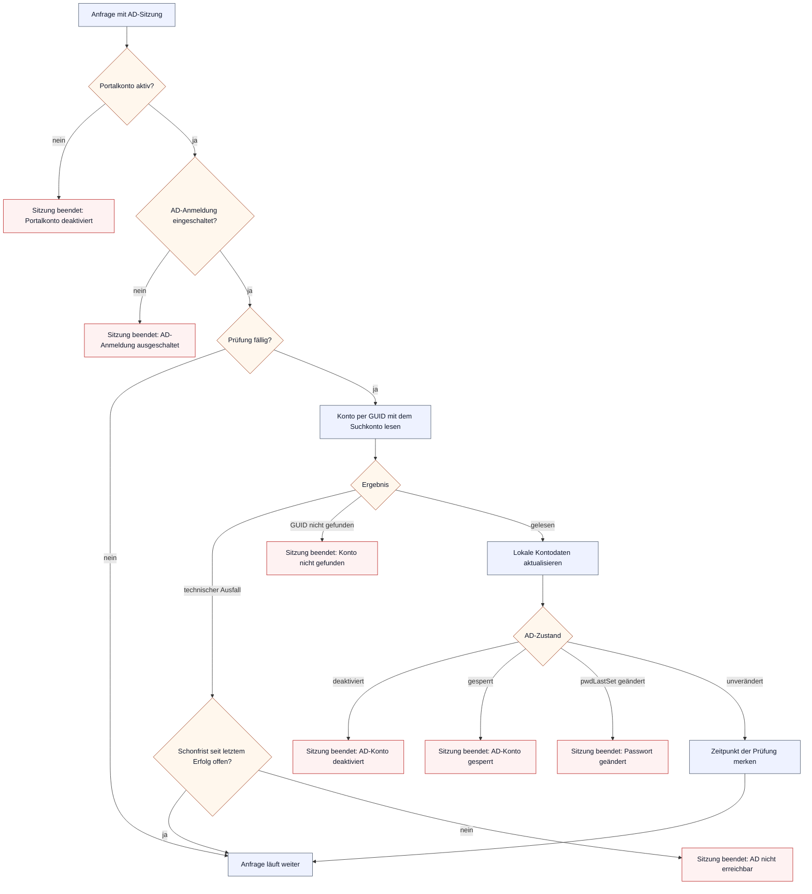

# Active Directory über LDAPS

VirtuSphere kann ausdrücklich importierte AD-DS-Konten über LDAPS anmelden. Die
Rolle, Aktivierung und Zulassung eines Kontos bleiben im Portal. Es gibt weder
automatische Provisionierung noch Gruppen-Mapping, lokales Ersatzpasswort oder
unverschlüsseltes LDAP.

## Voraussetzungen und Freigabegrenze

- Das Portal läuft mit aktiviertem HTTPS und HTTP-zu-HTTPS-Umleitung.
- Mindestens ein aktiver lokaler Administrator bleibt als Notzugang erhalten.
- Jeder Domänencontroller ist über einen FQDN erreichbar, der im Zertifikat
  enthalten ist. Der Standardport ist 636.
- Das hinterlegte CA-Bundle enthält die vollständige Vertrauenskette. Private
  Schlüssel und zusätzlicher Text werden abgewiesen.
- Das Suchkonto darf die benötigten Benutzerattribute und RootDSE lesen. Es
  benötigt keine administrativen Rechte. Pflicht sind unter anderem
  `objectGUID`, `userPrincipalName`, `userAccountControl` und `pwdLastSet`;
  fehlt eines davon oder ist es unlesbar, lehnt das Portal den Eintrag als
  `invalid_response` ab. Das berechnete Attribut
  `msDS-User-Account-Control-Computed` liefert die Kontosperre; fehlt es, gilt
  das Konto nur als nicht gesperrt erkannt.
- Die Sperrschwelle der AD-Kennwortrichtlinie passt zur Drossel des Portals:
  `5 × aufgerundet(Beobachtungsfenster / 15 min)` muss kleiner sein als die
  Schwelle (5 Fehlversuche je Name im 15-Minuten-Fenster des Portals). Sonst
  kann das Portal mit Fehleingaben ein AD-Konto sperren. Gate 0B prüft das in
  Schritt D7.
- Die Prüfungen aus
  `docs/audits/2026-08-13-ldaps-target-ad-validation-protocol.md` sind für jeden
  Ziel-DC dokumentiert. Vorher ist die Funktion nicht für Produktion freigegeben.
  Die nur lesende TLS-Probe dazu ist `scripts/gate0b-tls-probe.php`.

Die aktuelle Ausbaustufe prüft Zertifikatskette, Servernamen, Gültigkeitszeit,
Server-Auth-Eignung und TLS ab Version 1.2. Sie lädt zur Laufzeit keine OCSP-
oder CRL-Daten. Deshalb gehören rechtzeitige Zertifikatsrotation und kurze,
kontrollierte Zertifikatslaufzeiten zum Betriebskonzept.

## Einrichtung

1. Unter **Benutzer > Active Directory** Suchkonto als UPN, Passwort, CA-Bundle
   und optional die eingeschränkte Benutzer-Suchbasis speichern.
2. Einen beschreibbaren Domänencontroller mit seinem Zertifikats-FQDN
   hinzufügen, testen und aktivieren. RODCs werden nicht unterstützt.
3. Weitere Controller in gewünschter Priorität hinzufügen und ebenfalls testen.
4. Benutzer suchen, einzeln importieren, Rolle wählen und Aktiv-Status prüfen.
5. Die Verzeichnisanmeldung aktivieren. Der Server prüft HTTPS, Umleitung,
   lokalen Notfalladmin und mindestens einen für die aktuelle Revision
   freigegebenen Controller erneut.

Jede Änderung an Suchkonto, Passwort, CA oder Suchbasis erzeugt eine neue
Konfigurationsrevision. Frühere Controllerprüfungen gelten dann nicht mehr.
Ein Suchkonto-Passwort mit Nullzeichen oder über der Längengrenze
(`VIRTUSPHERE_DIRECTORY_PASSWORD_MAX_BYTES`) weist das Formular ab.

## Anmeldung

AD-Konten melden sich mit ihrem UPN (`name@domäne`) an; die Anmeldeseite zeigt
diesen Hinweis unter dem Namensfeld, sobald die AD-Anmeldung verfügbar ist.
Ein Name ohne UPN-Form, ein leeres Passwort, ein Passwort mit Nullzeichen oder
über der Längengrenze endet vor jedem DC-Kontakt und ohne Zählerstand mit
„ungültig“. So erreicht keine offensichtlich unbrauchbare Eingabe den DC und
dessen Fehlversuchszähler.

Lehnt der DC das Benutzerpasswort ab, sieht der Benutzer immer dieselbe
Meldung. Das Sicherheitsprotokoll nennt zusätzlich den typisierten Grund aus
dem AD-Unterschlüssel: Anmeldedaten ungültig, Passwort abgelaufen, Passwort
muss geändert werden, Konto gesperrt, deaktiviert, abgelaufen oder außerhalb
der Anmeldezeiten. Den Diagnosetext des DCs speichert das Portal nie; es
liest nur den Unterschlüssel daraus.

## Betrieb und Störungen

Der Systemstatus zeigt Aktivierung, Revision, Anzahl einsatzbereiter Controller,
den letzten erfolgreichen Kontakt sowie pro Controller Priorität, letzten Test,
letzten Erfolg, Zertifikatsablauf und einen typisierten Zustand (aktiv,
Zertifikat läuft bald ab, gestört, veraltet, nicht getestet). Die Gesamtampel
ist neutral ohne Konfiguration oder bei deaktiviertem AD, rot ohne
einsatzbereiten Controller, bei abgewiesenem Suchkonto oder wenn alle
einsatzbereiten Controller gestört sind, grün nur, wenn alle einsatzbereiten
Controller aktiv sind und kein aktivierter Controller für die aktuelle Revision
ungetestet ist, in jedem anderen Fall gelb (zum Beispiel bei veralteten
Controllern oder einem noch ungetesteten aktivierten Controller); die
Hilfe (Systemstatus-Tab) erklärt dieselbe Legende. Detailereignisse stehen im
Sicherheitsprotokoll in der Kategorie `directory`; Secrets, Benutzerpasswörter,
DNs und rohe LDAP-Fehler werden dort nicht gespeichert.

Den Zertifikatsablauf je Controller schreibt jeder manuelle Test. Zusätzlich
liest das Portal das Zertifikat nach einem erfolgreichen Verzeichniskontakt
(Anmeldung, Sitzungsprüfung oder Suche) höchstens einmal am Tag je Controller
und Revision über einen eigenen TLS-Handshake neu. Ein erneuertes
DC-Zertifikat erscheint dadurch spätestens am Folgetag mit dem neuen Ablauf.
Liegt der gespeicherte Ablauf in der Vergangenheit, gab es danach aber einen
erfolgreichen Kontakt, hat der DC offensichtlich ein neues Zertifikat: Der
Controller steht dann auf „veraltet“ statt „gestört“, bis der nächste Test
oder Lesevorgang den neuen Wert liefert.

Eine technische Störung (Verbindung, TLS, Timeout) darf auf den nächsten
priorisierten Controller ausweichen. Jede Antwortwartezeit ist durch die
verbleibende Frist der Anfrage begrenzt; ein DC, der nach dem TLS-Handshake
schweigt, kostet höchstens diese Frist und gilt dann als `timeout`. Eine
abgewiesene Benutzeranmeldung wird nicht gegen weitere Controller wiederholt.
Wird stattdessen das Suchkonto abgewiesen, öffnet sich der revisionsweite
Circuit Breaker, damit das Konto nicht durch automatische Wiederholungen
gesperrt wird. Der Systemstatus nennt dann den Grund: Passwort falsch,
Passwort abgelaufen oder muss geändert werden, Konto deaktiviert oder
abgelaufen, Konto gesperrt. Den Grund im AD beheben, das Passwort
gegebenenfalls neu speichern und einen Controller manuell erfolgreich testen,
um automatische Versuche wieder freizugeben. Ein Suchkonto mit ablaufendem
Passwort braucht deshalb einen Wechseltermin im Betriebsplan.

Als harte Obergrenze beendet PHP-FPM jede Portalanfrage nach 300 s
(`request_terminate_timeout`, gleich dem `fastcgi_read_timeout` von nginx).
Anfragen über 30 s meldet FPM mit Skriptnamen im Containerlog
(`docker compose logs php`, Meldung „executing too slow“). Eine eigene
Slowlog-Datei unter `logs/` gibt es nicht, weil der FPM-Master ohne
Dateirechte-Übersteuerung und ohne ptrace läuft; deshalb enthält die Meldung
auch keinen Backtrace. Die Grenze kommt mit dem neu gebauten `php`-Image
(Release nach N1a). Ein sehr langsamer Client beim Herunterladen eines großen
Roh-Deploylogs kann sie ebenfalls erreichen; der Download bricht dann ab.

## Sitzungsprüfung

Bestehende AD-Sitzungen werden regelmäßig
(`VIRTUSPHERE_DIRECTORY_SESSION_RECHECK_SECONDS`) über die unveränderliche
`objectGUID` mit dem Suchkonto geprüft. Bei jeder Anmeldung merkt sich die
Sitzung `pwdLastSet`; ältere Sitzungen ohne diesen Wert übernehmen ihn bei der
ersten erfolgreichen Prüfung. Das Ergebnis aktualisiert zuerst die lokalen
Kontodaten und entscheidet dann:



Jedes Sitzungsende schreibt `auth.session_ended` mit typisiertem Grund ins
Sicherheitsprotokoll und zerstört die Sitzung. Ein lokal deaktiviertes
Portalkonto verliert seine Sitzung sofort und endgültig; eine spätere
Reaktivierung belebt sie nicht wieder. Kurze technische Ausfälle nutzen die
begrenzte Schonfrist (`VIRTUSPHERE_DIRECTORY_SESSION_GRACE_SECONDS`) ab der
letzten erfolgreichen Prüfung.

## Zertifikatsrotation

Das neue CA-Bundle zuerst mit Überlappung der alten und neuen Vertrauenskette
speichern. Danach jeden Controller in bereits laufenden PHP-FPM-Workern testen.
Erst wenn Paralleltests und Negativfälle aus dem Ziel-AD-Protokoll grün sind,
alte CA-Zertifikate aus dem Bundle entfernen. Die abgeleiteten CA-Dateien liegen
nur im geschützten PHP-Laufzeitverzeichnis und sind kein Backupbestandteil.

Erneuert der AD-Betrieb nur ein DC-Zertifikat bei gleicher CA, genügt danach
**Verbindung testen** für diesen Controller; ohne Test zeigt der Systemstatus
den neuen Ablauf spätestens nach dem täglichen Lesen (siehe oben).

## Restore

Nach einem Restore muss einmal

```sh
docker exec virtusphere-v2-webapp-php-1 php /var/www/html/lib/directory_restore_converge.php
```

laufen. Der Schritt deaktiviert die AD-Anmeldung, erhöht die Revision und macht
alle früheren Controllerfreigaben unwirksam. Danach Konfiguration, CA,
Zielumgebung und HTTPS prüfen, Controller neu testen und AD bewusst wieder
aktivieren. `scripts/restore_test.sh` beweist diesen Schritt im isolierten Drill.
Der vollständige Restore-Ablauf in `backup.md` führt ihn vor dem Webserverstart
aus und rotiert anschließend separat die Paketbericht-Annahmegeneration.
