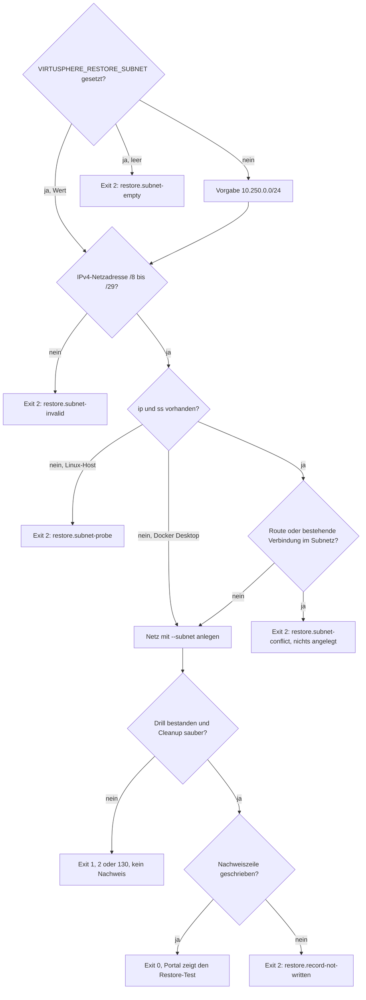

# Backup und Restore

VirtuSphere schreibt pro vollständigem Lauf ein Tripel nach `Docker/backups/` (gitignored):

1. `db-<ts>.sql.gz`: vollständiger Dump der Anwendungsdatenbank (Routines, Events, Trigger, `--single-transaction`).
2. `config-<ts>.tar.gz`: `.env`, `docker-compose.yml`, `docker-compose.override.yml` (falls vorhanden), nginx-Konfiguration und (falls vorhanden) SSL-Material.
3. `manifest-<ts>.sha256`: SHA-256-Nachweis für Dump und Konfigurationsarchiv; ein auswählbarer Backupstand braucht alle drei Dateien desselben Zeitstempels.

Ist im Portal ein Zertifikat hinterlegt, heißen 1. und 2. `db-<ts>.sql.gz.cms` und `config-<ts>.tar.gz.cms` und sind verschlüsselt (Abschnitt „Verschlüsselung“).

Die Override-Datei ist host-spezifisch und nicht in Git, und genau deshalb liegt sie im Archiv: der Produktionshost braucht sie zum Starten (Subnetz-Pins für `default` und `front`, damit keine Docker-Bridge das SSH abschneidet, geleerte Proxy-Umgebung je Service). Ein Restore ohne sie bringt den Stack nicht hoch, obwohl beide Archive intakt sind.

Nicht enthalten: `Docker/mysql/mysql-data/` (wird aus dem Dump wiederhergestellt), Laufzeit-Logs und die **Rechte des PHP-Logverzeichnisses**. Letztere sind Hostzustand, den kein Archiv erfasst: nach einem Restore auf einem Linux-Host `chmod 0777 Docker/WebAPI/logs` setzen, sonst kann der Fehlerhandler nicht schreiben (Begruendung in `docs/operations/go-live.md`, Schritt 1a). nginx schreibt in keinen Host-Logmount, sondern in die begrenzten Docker-Streams.

## Backup ausführen

```sh
sudo sh scripts/backup.sh
```

Auf einem Linux-Host mit `sudo`, so wie der Zeitplan, der als `root` läuft (siehe „Zeitplan einrichten“). `Docker/backups` gehört danach `root`, und das Skript legt Dump und Konfigurationsarchiv nur für `root` lesbar ab (Modus 0600; das Manifest enthält nur Prüfsummen). Ohne `sudo` scheitert ein Lauf von Hand daran, und der Restore-Drill kann die Archive nicht lesen. Liegen dort Dateien mit Modus 0644, das Verzeichnis selbst auf `chmod 700` setzen. Ein Wechsel auf das heutige Dumpformat (nur die Anwendungsdatenbank statt aller Datenbanken) macht den Dump deutlich kleiner; das ist kein Datenverlust, der Restore-Drill weist die Vollständigkeit über Tabellenzahl und Zeilenzählungen nach.

Voraussetzung: der Compose-Stack läuft (`virtusphere-v2-webapp-mysql-1`; abweichender Containername via `VIRTUSPHERE_MYSQL_CONTAINER`). Das Skript validiert den Dump (Mindestgröße, gzip-Integrität), schreibt danach das Manifest und behält von jeder Artefaktart die neuesten Dateien (`KEEP=14` in `scripts/backup.sh`, die SSoT für diesen Wert). Die Retention läuft getrennt je Artefaktart; unverschlüsselte und verschlüsselte Läufe einer Art bilden dabei eine gemeinsame Reihe, sodass alte Klartext-Backups nach `KEEP` verschlüsselten Läufen verschwinden. Ein Restore braucht weiterhin das vollständige Zeitstempel-Tripel. MySQL-Binlogs sind deaktiviert: Es gibt keinen Replikations- oder Point-in-Time-Recovery-Verbraucher, und der zugesagte Wiederherstellungspunkt ist ausschließlich ein erfolgreich geprüftes Backuptripel. Vorhandene historische Binlogdateien niemals direkt im Datenverzeichnis löschen.

Die Backup-Dateien enthalten Secrets (`.env`, DB-Inhalte inkl. verschlüsselter Credentials). `Docker/backups/` gehört auf ein zugriffsbeschränktes Ziel (`chmod 700`) und sollte zusätzlich auf einen zweiten Host synchronisiert werden (Pull vom Backup-Host, nicht Push vom App-Host). Beim Pull Punktdateien ausschließen (`rsync --exclude '.*'`): Klartext-Tempdateien mit führendem Punkt, etwa aus einem abgebrochenen Lauf, gehören nicht auf den zweiten Host. Meldet ein Lauf „verwaiste Klartext-Tempdateien entfernt“, ist auch der Backup-Host zu prüfen. Den `APP_KEY` zu wechseln beschreibt [APP_KEY wechseln](app-key-rotation.md); ältere Backups bleiben nur mit dem alten Schlüssel lesbar.

## Verschlüsselung (VT-E2, ADR-0017 Nachtrag)

Das Config-Archiv trägt den `APP_KEY`, der Dump die damit verschlüsselten ESXi-, Ansible- und LDAP-Zugangsdaten. Wer beide lesen kann, kann alle Zugangsdaten entschlüsseln. Deshalb verschlüsselt `scripts/backup.sh` beide Dateien an einen **öffentlichen Schlüssel**, sobald im Portal ein Zertifikat hinterlegt ist. Der private Schlüssel liegt offline bei der Bedienperson und nie auf dem App-Host.

**Schlüsselpaar erzeugen**, auf einem Rechner, der nicht der App-Host ist (OpenSSL 1.1 oder neuer):

```sh
openssl req -x509 -newkey rsa:4096 -nodes -keyout virtusphere-backup-key.pem -out virtusphere-backup-cert.pem -days 3650 -subj "/CN=VirtuSphere backup"
```

`virtusphere-backup-key.pem` ist der private Schlüssel: mindestens zweifach offline aufbewahren (etwa auf einem verschlüsselten Datenträger im Tresor und im Passwortsafe), nie auf den App-Host kopieren. Ohne ihn lassen sich verschlüsselte Backups nicht wiederherstellen. Das Zertifikat `virtusphere-backup-cert.pem` kommt unter **Einstellungen > System > Backup > Verschlüsselung** ins Portal (RSA, mindestens 3072 Bit; das Portal lehnt jeden privaten Schlüssel ab und speichert ihn nicht). Die Karte zeigt danach Inhaber, SHA-256-Fingerabdruck und Ablaufdatum. Das Ablaufdatum hindert die Verschlüsselung nicht; ein Wechsel vorher ist trotzdem ratsam.

**Was ein Lauf mit Zertifikat schreibt:** `db-<ts>.sql.gz.cms` und `config-<ts>.tar.gz.cms`, jeweils getrennt als CMS EnvelopedData (AES-256-CBC, RSA-Schlüsseltransport, DER) über `openssl cms` (`scripts/lib/backup_crypto.sh`); das Manifest hasht genau diese Dateien. Klartext entsteht nur als geschützte Tempdatei (Modus 0600) im Backup-Verzeichnis und wird am Ende jedes Laufs entfernt, auch nach einem Fehler. Bricht ein Lauf so hart ab, dass dieser Schritt nicht mehr läuft (Stromausfall, `kill -9`), bleiben Reste mit den Präfixen `.db-`, `.config-` und `.cert-` liegen. Der nächste Lauf entfernt sie, sobald er die Sperre (`flock`) hat, und meldet die Anzahl. Ohne `flock`, etwa unter Git Bash auf Windows, warnt der Lauf nur und räumt nicht auf. Das Zertifikat liest das Skript bei jedem Lauf aus der Datenbank; scheitert diese Abfrage oder die Verschlüsselung, schlägt der Lauf fehl, statt unverschlüsselt abzulegen. Ohne hinterlegtes Zertifikat schreibt der Lauf unverschlüsselt, und Systemstatus sowie Backup-Karte melden „Backups unverschlüsselt“.

**Grenze:** Die Verschlüsselung schützt die Vertraulichkeit, nicht die Echtheit. Wer das Zertifikat hat, kann gültige Umschläge erzeugen; Beschädigung erkennt weiterhin das Manifest. Deshalb CBC statt GCM, damit auch ein Restore-Rechner mit OpenSSL 1.1 entschlüsseln kann. Beim Entschlüsseln liest `openssl cms` die ganze Datei in den Speicher; der Restore-Rechner braucht freien Arbeitsspeicher mindestens in Größe des Dumps.

**Pin des Zertifikats (optional):** Wer den Fingerabdruck des Zertifikats in der Konfiguration festschreiben will, setzt in `.env` `VIRTUSPHERE_BACKUP_RECIPIENT_SHA256` auf den SHA-256-Fingerabdruck des Zertifikats. Der Wert darf in jeder üblichen Schreibweise stehen: klein ohne Trennzeichen (wie auf der Karte im Portal), groß, mit Doppelpunkten, als Ausgabe von `openssl x509 -fingerprint -sha256` mit dem Präfix `SHA256 Fingerprint=`, in Anführungszeichen oder mit Windows-Zeilenende. Ist der Pin gesetzt, scheitert jeder Lauf, dessen Zertifikat nicht passt. Ebenso scheitert er, wenn im Portal kein Zertifikat hinterlegt ist, damit das Entfernen des Zertifikats nicht zu unverschlüsselten Backups führt, oder wenn der Wert nach dem Normalisieren keine 64 Hexzeichen ergibt. Gelesen wird nur die Datei `.env`, nie die Umgebung des Prozesses. Steht der Schlüssel mehrfach in `.env`, gilt die erste Zeile. Ohne Pin prüft der Lauf keinen Fingerabdruck. Der Restore-Drill liest den Pin nicht. Nach einem Restore auf einen neuen Host kommen `.env` mit dem Pin (aus dem Config-Archiv) und das Zertifikat (aus dem Dump) gemeinsam zurück.

**Schlüsselwechsel:** neues Paar erzeugen. Dann zwei Schritte direkt hintereinander: das Zertifikat im Portal ersetzen und, falls ein Pin gesetzt ist, `VIRTUSPHERE_BACKUP_RECIPIENT_SHA256` in `.env` auf den neuen Fingerabdruck setzen. Ist ein Pin gesetzt, scheitert jeder Lauf dazwischen laut. Das gilt in jeder Reihenfolge, weil Zertifikat und Pin dann nicht übereinstimmen; es entsteht kein Backup, das niemand bestellt hat. Danach einmal `sudo sh scripts/backup.sh` von Hand laufen lassen und die Statuszeile prüfen: `encrypted` ist `true`, `recipient_sha256` ist der neue Fingerabdruck. Ab dem nächsten Lauf gilt der neue Schlüssel; ältere Backups brauchen weiter den alten privaten Schlüssel, bis die Retention sie entfernt hat. Den alten Schlüssel erst danach vernichten. Bestehende unverschlüsselte Backups bleiben bis zum Ende der Aufbewahrung liegen; wer sie sofort loswerden will, löscht sie von Hand.

**Entschlüsseln** auf dem Rechner mit dem privaten Schlüssel. Die Klartextdateien kommen in ein Arbeitsverzeichnis außerhalb von `Docker/backups/`, hier `RESTORE_WORK`, etwa `RESTORE_WORK=restore-work; mkdir -p "$RESTORE_WORK"` neben dem Projektordner. Klartext gehört nie nach `Docker/backups/` (Begründung unter „Echter Restore“):

```sh
openssl cms -decrypt -binary -inform DER -in db-<ts>.sql.gz.cms -inkey virtusphere-backup-key.pem -out "$RESTORE_WORK/db-<ts>.sql.gz"
openssl cms -decrypt -binary -inform DER -in config-<ts>.tar.gz.cms -inkey virtusphere-backup-key.pem -out "$RESTORE_WORK/config-<ts>.tar.gz"
```

## Zeitplan einrichten (ADR-0024)

Der Zeitplan lebt an genau einer Stelle: dem Cron-Eintrag auf dem Docker-Host. Ein Befehl schreibt ihn:

```sh
sudo sh scripts/install-backup-schedule.sh                        # täglich 06:00
sudo sh scripts/install-backup-schedule.sh --schedule "30 2 * * *"
sh scripts/install-backup-schedule.sh --show                      # aktuellen Eintrag zeigen
sudo sh scripts/install-backup-schedule.sh --remove
```

Das Ergebnis liegt in `/etc/cron.d/virtusphere-backup` und startet `scripts/backup.sh` im Projektverzeichnis; die Ausgabe geht nach `/var/log/virtusphere-backup.log`.

Kein zweiter Sollwert wird gepflegt: `backup.sh` liest bei jedem Lauf genau diese Datei zurück (inklusive `CRON_TZ`) und meldet den gefundenen Zeitplan in der Statuszeile mit. Das Portal rechnet daraus den nächsten Lauf. Erkennungsreihenfolge im Skript:

1. `VIRTUSPHERE_BACKUP_SCHEDULE` (explizite Vorgabe, überstimmt alles).
2. systemd-Timer (`VIRTUSPHERE_BACKUP_TIMER_UNIT`, Standard `virtusphere-backup.timer`): meldet mit `NextElapseUSecRealtime` den nächsten Lauf exakt.
3. `/etc/cron.d/virtusphere-backup` bzw. `VIRTUSPHERE_BACKUP_CRON_FILE`.
4. `crontab -l` des aufrufenden Benutzers.

Greift nichts davon, bleiben die Felder leer; die Karte kennzeichnet den nächsten Lauf dann ausdrücklich als Schätzung aus dem letzten Lauf.

### Andere Hintergrundaufgaben

Das Backup ist der einzige Cron-Job. Deploy-Worker (alle 5 s) und Wartungs-Worker (alle 15 s, darin die Retention-Aufräumjobs und der ESXi-Inventar-Abruf nach eingestelltem Intervall; der Wartungs-Worker führt keine MECM-Probe mehr aus) sind Dauerläufer im Compose-Stack und brauchen keinen Zeitplan.

## Statuskanal und Portal-Anzeige (ADR-0021)

Jeder Lauf hängt eine JSON-Zeile an `Docker/backups/status/backup-status.jsonl` an: `ts` (Unix-Epoch), `status` (`ok`/`failed`), `db_bytes`, `config_bytes`, `duration_s`, `keep`, `disk_free_pct`, `disk_free_bytes`, `error` sowie den Zeitplan-Kanal aus ADR-0024: `schedule` (Cron-Ausdruck), `schedule_tz`, `schedule_source` (Fundort) und `next_ts` (exakter nächster Lauf, nur bei systemd-Timer), dazu `encrypted` (`true`/`false`) und `recipient_sha256` (Fingerabdruck des Zertifikats, an das verschlüsselt wurde, sonst leer). Die Datei wird auf die neuesten 90 Zeilen gekappt und ist reine Metadaten (wird selbst nicht mitgesichert). Zeilen aus der Zeit vor ADR-0024 haben die Zeitplanfelder nicht; der Reader fällt dann auf die Intervall-Schätzung zurück.

Nur dieses Unterverzeichnis wird read-only in den PHP-Container gemountet (`./Docker/backups/status:/var/backups/virtusphere-status:ro`), nie die Dumps oder das Config-Tar (das die `.env` mit dem DB-Root-Passwort enthält). Ein Dump-Download über das Portal gibt es bewusst nicht. Der Missions-Export (JSON) ist ein Transportweg zwischen Umgebungen, der Listen-Export (CSV) nur ein Tabellen-Export für Berichte; beides ist kein Backup und kein Restore-Pfad.

Neben der Statuszeile der Backupläufe liegen im selben Verzeichnis zwei Nachweise, die nie in `backup-status.jsonl` landen (eine Drill-Zeile dort läse das Portal als Backuplauf): `restore-drill.jsonl` (je bestandenem Drill eine Zeile `ts`, `status` = `ok`, `backup_ts`, `root_commit`; auf 90 Zeilen gekappt) schreibt der Drill `scripts/restore_test.sh` selbst als letzten Schritt, siehe „Nachweis im Portal“; `backup-scrub.json` (ein Objekt `ts`, `status`, `sets_checked`, `sets_failed`, `failed_sets`, `duration_s`, atomar ersetzt) schreibt `scripts/backup-scrub.sh`, siehe „Prüfsummen-Scrub“.

Das Portal liest die Backupläufe an genau einer Stelle (`lib/backup_status.php`), die beiden Nachweise in `lib/backup_evidence.php`, und zeigt:

- **Backup-Karte** auf der Einstellungen-Seite (`settings.php`, Gate `system.config`): Zustand, Zeitplan samt Fundort, letzter Lauf, Alter, nächster Lauf, Überfälligkeitsgrenze, letzter Restore-Test (Zeitpunkt und Alter aus `restore-drill.jsonl`, Plakette „Fällig“ ab `VIRTUSPHERE_RESTORE_DRILL_DUE_DAYS` Tagen; ohne Nachweis „Nicht nachgewiesen“; in beiden Fällen mit dem Drill-Befehl), Größen, freier Speicher, Aufbewahrung. Darunter stehen nur der Einrichtungs-Befehl für den Cron-Zeitplan und ein Link in die Hilfe (Tab "Architektur"), die Ablauf, Ablageort und Restore-Weg erklärt; der frühere aufklappbare Erklärtext war ein Duplikat dieser Hilfe-Abschnitte.
- **Dashboard-Banner** für Admins, sobald der Zustand nicht `ok` ist (fail-soft; ein defekter Reader legt keine Seite lahm).
- **Systemstatus**, Abschnitt „Host und Backup“ mit eigener Kachel im Überblick: je eine Zeile für Backup (Zustand, letzter Lauf), Restore-Test (letzter nachgewiesener Erfolg „vor N Tagen“, geprüfter Stand; Hinweis „Fällig“ ab `VIRTUSPHERE_RESTORE_DRILL_DUE_DAYS` Tagen), Prüfsummen (letzte Prüfung, Ergebnis) und, nur solange nginx HTTPS ausliefert, das HTTPS-Zertifikat (Ablaufdatum, Hinweis ab `VIRTUSPHERE_HTTPS_CERT_EXPIRY_WARN_DAYS` Tagen). Fehlt ein Nachweis, steht „Unbekannt“, nie „OK“. Die Kachel „Host und Backup“ zeigt die schlechteste Zeile; „Unbekannt“ macht sie grau, nie grün. Die Zeilen ändern die Ampel der Kachel „Interne Dienste“ nicht.
- **health.php** meldet den Backupzustand nicht; es liefert nur `status`, `db` und `php`. Backupzustand und -alter stehen ausschließlich im Portal.

Abgeleitete Zustände (Schwere `failed` > `stale` > `disk_low`): `ok`, `failed` (letzter Lauf gescheitert), `stale` (der erwartete Lauf blieb samt Kulanzzeit aus), `disk_low` (freier Speicher unter 10 %), `unknown` (kein lesbarer Status: Skript lief nie oder der Mount fehlt).

Die Überfälligkeitsgrenze ist der *erwartete* Lauf plus `VIRTUSPHERE_BACKUP_GRACE_SECONDS` (2 h), nicht ein festes Alter. Ist ein Zeitplan gemeldet, stammt der erwartete Lauf daraus; sonst aus `VIRTUSPHERE_BACKUP_INTERVAL_SECONDS` (24 h). Ein wöchentliches Backup gilt damit nicht mehr dauerhaft als veraltet.

## Restore-Drill

Ein Backup ist erst dann ein Backup, wenn der Restore bewiesen ist:

```sh
sudo sh scripts/restore_test.sh
```

Mit `sudo` aus demselben Grund wie das Backup: Dump und Konfigurationsarchiv sind nur für `root` lesbar. Vor einem Update läuft der Drill noch mit dem laufenden Stand und **vor** dem Laden oder Bauen neuer Images, weil er die Images über ihre Namen findet ([Update-Runbook](update.md), Schritt 3.2).

Ohne weitere Vorgabe verwendet der Drill das Repository, zu dem dieses Skript
gehört. Der kanonische Runner setzt `VIRTUSPHERE_CHECK_ROOT` auf seinen
normalisierten Prüfroot. Ein direkter, bewusst gegen eine andere Datenkopie
gerichteter Aufruf kann dieselbe Variable setzen. Dann kommen das jüngste
Backuptripel, `struktur.sql`, Migrationen, Directory-Konvergenz, Restore-Probe
und der in die Wegwerfcontainer gemountete Anwendungscode vollständig aus
diesem Root. Ein direkt beim Shellaufruf explizit leer gesetzter Root sowie ein
fehlender oder unvollständiger expliziter Root bricht begrenzt ab; der Drill
fällt nie auf Backups neben dem Checker zurück. `check.ps1` behandelt eine
eingehende leere Variable dagegen als nicht gesetzt und exportiert seinen
normalisierten Standardroot. Die Ausgabe verbindet den normalisierten Prüfroot
mit dem ausgewählten Backupstand, damit die Gateevidenz beide eindeutig
zuordnet.

Das Backuptripel kann getrennt vom Prüfroot aus
`VIRTUSPHERE_RESTORE_BACKUP_DIR` kommen (Standard: `<Prüfroot>/Docker/backups`).
Dafür gilt dieselbe Strenge: explizit leer gesetzt endet der Drill mit
`[restore.backup-dir-empty]`, ein fehlendes Verzeichnis mit
`[restore.backup-dir-missing]`, ein Verzeichnis ohne Tripel mit
`[restore.backup-missing]`, jeweils Exitcode 2 und ohne Rückfall auf das
Verzeichnis im Prüfroot. Ein relativer Pfad gilt ab dem Aufrufverzeichnis. Dump,
Konfigurationsarchiv und Manifest dort werden nur gelesen; geschrieben wird nur
nach bestandenem Drill die Nachweiszeile unter `status/` („Nachweis im
Portal“). Wofür die Trennung da ist, steht unter
„Migrations-Probelauf mit dem neuen Stand“.

Vor dem Import nennt der Drill seine Quellen in drei Zeilen, damit ein Nachweis
eindeutig einem Stand zugeordnet bleibt, und in einer vierten das Subnetz seines
Wegwerf-Netzes („Subnetz des Drills“):

```text
Restore-Drill Auswahl: Pruefroot=<Pfad>; Backup-Stand=<ts>
Restore-Drill Quelle: Pruefroot-Commit=<Commit>; Backupverzeichnis=<Pfad> (aus Pruefroot|VIRTUSPHERE_RESTORE_BACKUP_DIR)
Restore-Drill Images: PHP=<Name> (sha256:…); MySQL=<Name> (sha256:…)
Restore-Drill Netz: Subnetz=<Subnetz> (aus Vorgabe|VIRTUSPHERE_RESTORE_SUBNET); geprueft: Routen und Verbindungen
```

Der Commit ist der des Prüfroots selbst; `(Arbeitsbaum geaendert)` dahinter
heißt, dass getrackte Dateien vom Commit abweichen. `unbekannt` steht dort, wenn
der Prüfroot kein eigener Git-Checkout ist oder `git` fehlt oder den Zugriff
verweigert. Die Schlusszeile `Restore-Drill OK` wiederholt Backupstand und
Commit.

Der Drill arbeitet vollständig in einer Wegwerf-Umgebung (eigenes Docker-Netz mit festem Subnetz, Wegwerf-MySQL mit dem lokal getaggten Stack-Image `mysql:8.4-virtusphere`, Projekt-PHP-Image) und prüft die ganze Kette. Der Wegwerf-Server entsteht dabei wie der Produktionsstack, mit dem App-User aus der archivierten `.env` (`MYSQL_USER`/`MYSQL_PASSWORD`), und **alles ab den Migrationen verbindet als dieser App-User, nie als root**: genau so verbindet die App, und genau diese Fähigkeit hatte der Drill früher nie bewiesen.

1. Manifest (`manifest-<ts>.sha256`, schreibt `scripts/backup.sh` bei jedem Lauf): Es muss genau die gewählten Archive listen, also Dump und Konfigurationsarchiv desselben Zeitstempels (bei verschlüsseltem Tripel deren `.cms`-Namen), und deren SHA-256-Hashes müssen stimmen. Sonst endet der Drill mit `[restore.manifest-mismatch]` (Exitcode 1), bevor etwas entschlüsselt oder ein Container angelegt wird.
1b. Ist das jüngste Tripel verschlüsselt (`*.cms`), entschlüsselt der Drill beide Archive mit dem privaten Schlüssel aus `VIRTUSPHERE_BACKUP_PRIVATE_KEY` ins Wegwerf-Arbeitsverzeichnis. Fehlt die Variable oder ist die Datei nicht lesbar, endet der Drill als fehlende Voraussetzung (`[restore.key-missing]`, Exitcode 2), nie als bestanden. Den Drill dafür auf einem Rechner mit dem Schlüssel ausführen, nicht auf dem App-Host.
2. Dateirechte von `.env` und SSL-Schlüsseln im Config-Archiv (auf Windows-Hosts nur Warnung, POSIX-Modi sind dort nicht abbildbar)
3. Import des jüngsten Dumps, erst wenn der endgültige Wegwerf-Server über TCP antwortet (Begründung unter „Echter Restore“, Schritt 3; nach 300 s ohne Antwort endet der Drill mit `[restore.mysql-not-ready]` als fehlende Voraussetzung, Exitcode 2), danach `FLUSH PRIVILEGES` (wie der Neustart im Ernstfall) und die Arbeitsprobe des App-Users; ein Alt-Archiv (`--all-databases`) wird erkannt und durchläuft den unten dokumentierten Grant-Reparaturschritt
4. Tabellenzahl Dump gegen Restore, Migrationen bis `pending=0`, danach AD-Konvergenz und Rotation der Paketbericht-Annahmegeneration sowie Schema-Fingerprint gegen das frische `struktur.sql`
5. Invarianten und Rowcounts (Benutzer, Migrationstracking, keine verwaisten Interfaces/VMs/Jobs)
6. Credential-Entschlüsselung mit dem `APP_KEY` aus dem gesicherten `.env`, und erwartetes Scheitern mit einem falschen Schlüssel
7. App-Smoke gegen die wiederhergestellten Daten: `health.php`, Portal-Login mit einem Drill-Admin, Machine-API-Ablehnung einer nicht freigegebenen IP (eingefrorene 403-Antwort von `mecm-api.php`)
8. Vollständiges Cleanup per Trap: Container, das anonyme Datenvolume des Wegwerf-MySQL (sonst bliebe nach jedem Lauf eine Kopie der Datenbank im Docker-Datenbereich liegen), Netz und Arbeitsverzeichnis; der laufende Stack wird nie berührt
9. Nur nach bestandenem Drill und sauberem Cleanup: die Nachweiszeile für das Portal (Schritt `[11/11] drill-record`, „Nachweis im Portal“)

Kadenz: Release-Lane des kanonischen Runners (`scripts/check.ps1 -Lane Release`, Gate `restore-drill`), nach jedem Schema-Meilenstein, mindestens monatlich und als Migrations-Probelauf vor jedem Update mit neuen Migrationen.

### Subnetz des Drills

Ohne Vorgabe legt Docker ein neues Netz in seinem Standardbereich an (`172.17.0.0/16` bis `172.31.0.0/16`, `192.168.0.0/16`). Liegt die Adresse, über die der Betreiber per SSH kommt, in diesem Bereich, gehen die Antworten des Hosts an die neue Bridge, und die Sitzung bricht ab, mitten im Drill. Dieselbe Falle beschreibt [Go-Live](go-live.md), Schritt 1a.2, für die Netze des Stacks. Der Drill legt sein Wegwerf-Netz deshalb immer mit festem Subnetz an:

- Vorgabe ist `10.250.0.0/24`, ein privates Subnetz außerhalb der Docker-Standardbereiche.
- Ein Host, in dessen Netz die Vorgabe vorkommt, setzt `VIRTUSPHERE_RESTORE_SUBNET` auf ein eigenes freies Subnetz. Es darf sich mit keinem Netz überschneiden, das der Host erreicht, und mit keinem Subnetz-Pin der Override. Erlaubt ist eine IPv4-Netzadresse mit Präfix `/8` bis `/29` ohne gesetzte Hostbits. `sudo` gibt die Variable nur als Argument weiter, als der Betriebsnutzer mit vollem Pfad:

  ```sh
  cd /opt/VirtuSphere-v2-WebApp
  sudo VIRTUSPHERE_RESTORE_SUBNET=<freies-/24> sh scripts/restore_test.sh
  ```

  Gesetzt, aber leer endet der Drill mit `[restore.subnet-empty]`, ein ungültiger Wert mit `[restore.subnet-invalid]`, jeweils Exitcode 2 und ohne Rückfall auf die Vorgabe. Das tatsächliche Subnetz eines Standorts gehört in seine Betriebsnotizen, nicht ins Repository.

Bevor das Netz entsteht, prüft der Drill auf einem Linux-Host mit `ip -4 route show` und `ss -tn state established` (beides aus iproute2), dass das Subnetz keine Route des Hosts überdeckt (eigenes LAN, ein Docker-Netz, der Rest eines abgebrochenen Drills) und keine Adresse einer bestehenden TCP-Verbindung enthält. Die zweite Prüfung findet auch eine SSH-Sitzung, die über das Default-Gateway kommt und deshalb in keiner Route steht. Ein Treffer endet vor jeder Änderung mit `[restore.subnet-conflict]` und Exitcode 2; die Meldung nennt die Route oder die Adresse. Fehlt `ip` oder `ss` auf einem Linux-Host, endet der Drill mit `[restore.subnet-probe]`, nie mit einem stillen Grün. Auf Docker Desktop liegt das Netz in der Docker-VM; dort entfällt die Prüfung, und die Zeile `Restore-Drill Netz` sagt das. Eine Sitzung, die erst nach der Prüfung aus dem Subnetz heraus aufgebaut wird, sieht der Drill nicht.

Belegt ein anderes Docker-Netz das Subnetz schon, lehnt Docker das Anlegen ab, und der Drill endet mit `[restore.network-create]` (Exitcode 2). Reste eines abgebrochenen Drills zeigt `docker network ls --filter label=virtusphere.qa.probe`; sie lassen sich mit `docker network rm <ID>` entfernen, nachdem kein Drill mehr läuft. Zwei Drills gleichzeitig auf demselben Host gehen deshalb nicht; die Release-Lane läuft ohnehin nacheinander.



### Nachweis im Portal

Der Drill schreibt seinen Nachweis selbst. Als letzten Schritt (`[11/11] drill-record`), nur wenn alle Prüfungen bestanden und das Cleanup sauber war, hängt er eine Zeile an `status/restore-drill.jsonl` in dem Backupverzeichnis an, aus dem er gelesen hat (die Zeile `Restore-Drill Quelle` nennt es), atomar über eine Tempdatei im selben Verzeichnis und gekappt auf 90 Zeilen. Danach meldet er:

```text
Restore-Drill Nachweis: <Backupverzeichnis>/status/restore-drill.jsonl (Backup-Stand <ts>)
```

Ein Befund (1), eine fehlende Voraussetzung (2), ein abgebrochener Lauf oder ein gescheitertes Cleanup schreibt nichts. Bestand der Drill, ließ sich der Nachweis aber nicht schreiben, endet er mit 2 und `[restore.record-not-written]`; das Portal bleibt dann bei „Unbekannt“. Ein eigener Aufruf dafür ist nicht nötig; das frühere `scripts/restore-drill-record.sh` ist entfallen.

Den Nachweis zeigen der Systemstatus (Abschnitt „Host und Backup“) und die Backup-Karte in den Einstellungen. Läuft der Drill auf einem anderen Rechner (etwa weil dort der private Schlüssel für verschlüsselte Backups liegt), entsteht der Nachweis dort und nicht auf dem App-Host. Beide Anzeigen bleiben dann ehrlich bei „Unbekannt“ beziehungsweise „Nicht nachgewiesen“. Auch der Migrations-Probelauf und das Gate `restore-drill` der Release-Lane schreiben bei Erfolg eine Zeile in das Backupverzeichnis, aus dem sie gelesen haben: Sie haben genau dieses Backup erfolgreich wiederhergestellt.

### Migrations-Probelauf mit dem neuen Stand

Der Drill vor einem Update ([Update-Runbook](update.md), Schritt 3.2) beweist, dass das Backup des **laufenden** Stands wiederherstellbar ist. Die Migrationen des neuen Releases laufen dabei nie. Auf echte Daten treffen sie sonst erst im Wartungsfenster, und ab der ersten Klasse-C-Migration ([Upgrade-Recovery](upgrade-recovery.md)) bleibt dort nur der Restore. Der Probelauf ist derselbe Drill mit dem Code des neuen Stands als Prüfroot und dem vorhandenen Backup als Quelle: Er spielt eine Kopie der echten Daten in die Wegwerf-Umgebung ein, wendet alle offenen Migrationen an und vergleicht das Ergebnis mit dem `struktur.sql` des neuen Stands. Datenabhängige Fehler (Zeilen, die eine neue Einschränkung verletzen; Laufzeit) zeigen sich so vor dem Fenster.

**Vorab, außerhalb des Fensters**, sobald der neue Stand auf dem Host liegt:

1. Den neuen Stand als eigenen Klon neben den laufenden Checkout legen. Der Klon braucht weder `.env` noch `Docker/backups`; Backup und `.env` nicht dorthin oder ins Home-Verzeichnis kopieren.
2. Den Drill aus dem Klon starten und das Backupverzeichnis des laufenden Checkouts benennen. `sudo` gibt Umgebungsvariablen nur als Argument weiter:

   ```sh
   cd <neuer-Klon>
   sudo VIRTUSPHERE_RESTORE_BACKUP_DIR=/opt/VirtuSphere-v2-WebApp/Docker/backups sh scripts/restore_test.sh
   ```

   Quelle ist das jüngste Tripel dort, in der Regel das nächtliche aus dem Zeitplan. Der Drill mountet das Verzeichnis in keinen Container und verschiebt oder löscht dort nichts; nach bestandenem Drill schreibt er nur eine Zeile in `status/restore-drill.jsonl` dieses Verzeichnisses („Nachweis im Portal“). Auf einem Host, in dessen Netz das Vorgabe-Subnetz vorkommt, kommt `VIRTUSPHERE_RESTORE_SUBNET` als weiteres Argument dazu („Subnetz des Drills“). Entschlüsselte Archive und die archivierte `.env` liegen nur im Wegwerf-Arbeitsverzeichnis, das der Cleanup entfernt. Platzbedarf während des Laufs: die entpackte Datenbank im Docker-Datenbereich und bei verschlüsseltem Backup die entschlüsselten Archive im Temp-Verzeichnis; beides ist nach dem Lauf wieder frei.
3. Die Zeile `Restore-Drill Quelle` prüfen: `Pruefroot-Commit` muss der Commit des neuen Stands sein, ohne `(Arbeitsbaum geaendert)`. Steht dort `unbekannt`, den Commit mit `git -C <neuer-Klon> rev-parse HEAD` von Hand zum Ergebnis notieren.

Vorab findet der Drill die Images über ihre Namen, also in der Regel die laufenden; die Zeile `Restore-Drill Images` nennt ihre IDs. Ein Wechsel des PHP- oder MySQL-Images ist damit erst im zweiten Lauf im Fenster geprüft.

Grün (`Restore-Drill OK`, Exitcode 0) heißt: Die Migrationen des neuen Stands laufen auf diesem Datenstand durch, und das Schema stimmt. Rot (Exitcode 1) ist ein Befund am neuen Stand, nicht am Backup: Den Rollout nicht ansetzen und die Ausgabe an die Entwicklung geben; der laufende Stand bleibt unberührt. Exitcode 2 ist eine fehlende Voraussetzung und kein Nachweis.

**Im Fenster** läuft derselbe Drill ein zweites Mal ([Update-Runbook](update.md), Schritt 3.6a): nach dem Umstellen des Checkouts und dem Laden der neuen Images, vor dem Migrationsschritt. Prüfroot und Backupverzeichnis sind dann wieder derselbe Checkout, die Variable entfällt, und Quelle ist das eben geschriebene Backup. Rot heißt dort Abbruch vor der Migration, solange der Rückweg noch „alte Quellen und Images zurück“ ist.

`Docker/scripts/backup.sh` und `Docker/scripts/restore.sh` sind stillgelegt: Ein zweiter, unvalidierter Pfad wäre gefährlich, deshalb brechen sie absichtlich mit einem Verweis hierher ab.

## Prüfsummen-Scrub

Zwischen Backup und Drill prüft nichts die Altbestände auf Bitfehler oder Teilschreiben. Das macht der Scrub, nur lesend:

```sh
sudo sh scripts/backup-scrub.sh
```

Er liest jedes `manifest-<ts>.sha256` in `Docker/backups/` und vergleicht die Ist-Hashes der gelisteten Archive mit denen, die `backup.sh` beim Lauf geschrieben hat. Ein Satz gilt nur, wenn sein Manifest genau Dump und Konfigurationsarchiv desselben Zeitstempels nennt. Verschlüsselte Sätze prüft er ohne Schlüssel, weil das Manifest die `.cms`-Dateien hasht. Kein Backup wird geändert, verschoben oder gelöscht; geschrieben wird nur `status/backup-scrub.json`. Fortschritt je Satz als `[n/total]`.

Der Scrub nimmt die Backup-Sperre nicht, weil `backup.sh` bei belegter Sperre abbricht. Rotiert ein laufendes Backup einen alten Satz weg, zählt dieser Satz nicht. Exitcodes: 0 alle Sätze stimmen; 1 mindestens ein Satz weicht ab oder ist unvollständig (`failed_sets` nennt die Zeitstempel; diese Sätze nicht für einen Restore verwenden); 2 fehlende Voraussetzung (kein Satz, `sha256sum` fehlt, Datei ohne `sudo` nicht lesbar), dann bleibt das vorige Ergebnis stehen.

Einen eigenen Zeitplan richtet das Skript nicht ein. Sinnvoll ist ein Lauf zusammen mit dem monatlichen Drill.

## Echter Restore (Desaster-Fall)

Der vollständige Versions-, Schema- und Rückkehrvertrag steht ergänzend in
[`upgrade-recovery.md`](upgrade-recovery.md). Das Rootpasswort bleibt in diesem
Host-/MySQL-Ablauf; es wird keinem PHP- oder Worker-Runtimecontainer mitgegeben.

1. Stack stoppen: `docker compose --profile tools down`. Ohne das Profil bleibt ein bei Bedarf gestartetes phpMyAdmin mit seiner Verbindung zur Datenbank stehen.
2. Defekte Daten wegräumen: `Docker/mysql/mysql-data/` sichern/leeren.
3. Nur MySQL starten und auf den endgültigen Server warten: `docker compose up -d --wait mysql`. Der Befehl muss ohne Fehler enden, erst dann einspielen. Bei leerem Datenverzeichnis legt der Entrypoint des Images die Datenbank zuerst mit einem temporären Server an, der nur über den Socket erreichbar ist (`--skip-networking`), spielt dort `struktur.sql` ein und startet danach den endgültigen Server. Ein Import in dieser Zeit landet im temporären Server und bricht bei dessen Ende halb eingespielt ab (`ERROR 2013`), oder er findet gar keinen Server (`ERROR 2002`). Eine eigene Probe mit `mysql -uroot … -e 'SELECT 1'` hilft nicht, sie geht ebenfalls über den Socket. `--wait` wartet auf den Healthcheck des Dienstes, der über TCP (`127.0.0.1`) fragt und deshalb erst den endgültigen Server sieht. Endet `--wait` mit einem Fehler: nicht einspielen, `docker compose logs mysql` lesen und den Befehl nach behobener Ursache wiederholen. Ein Import, der abgebrochen ist, wird nicht einfach erneut gestartet: Datenverzeichnis wieder leeren (Schritt 2) und ab Schritt 3 neu beginnen.
4. Dump einspielen. Ein verschlüsseltes Tripel wird vorher wie unter „Verschlüsselung“ beschrieben auf dem Rechner mit dem privaten Schlüssel entschlüsselt. Nur die Klartextdateien kommen auf den Zielhost, ebenfalls in ein Arbeitsverzeichnis außerhalb von `Docker/backups/`, hier `RESTORE_WORK` (siehe „Entschlüsseln“):
   ```sh
   gunzip -c "$RESTORE_WORK/db-<ts>.sql.gz" | docker compose exec -T mysql mysql -uroot -p"$MYSQL_ROOT_PASSWORD"
   ```
   Bei einem unverschlüsselten Tripel entfällt die Kopie; dann liest der Befehl `Docker/backups/db-<ts>.sql.gz` direkt. Klartextkopien gehören nicht nach `Docker/backups/`: Dort zählt eine Kopie als jüngster Lauf ihrer Reihe, sodass die Retention (`KEEP`) ein älteres Tripel zu früh verdrängt. Außerdem läge sie bis zu `KEEP` Läufe lang im Klartext im synchronisierten Verzeichnis. Und der Restore-Drill lehnt ein Tripel ab, dessen Manifest die Klartextnamen nicht listet (`[restore.manifest-mismatch]`).
4a. **Nur bei einem Alt-Archiv** (Dump aus der Zeit vor dem Formatwechsel, erkennbar an `-- Current Database: mysql` im Dump; neue Dumps enthalten nur die Anwendungsdatenbank): der Import hat die mysql-Grant-Tabellen mitgebracht und ersetzt damit die Konten des Zielservers durch den archivierten Stand. Zwei Folgen, beide mit dem archivierten `.env` behebbar. Erstens kann nach dem nächsten `FLUSH PRIVILEGES`/Neustart das **Root-Passwort** das aus der archivierten `.env` sein statt des aktuellen. Zweitens passt der **App-User** nach einer Passwortrotation nicht mehr zur aktuellen `.env`; dann die Grants aus der wirksamen `.env` neu setzen:
   ```sh
   docker compose exec -T mysql mysql -uroot -p"<wirksames Root-Passwort>" <<'SQL'
   CREATE USER IF NOT EXISTS '<DB_USER>'@'%' IDENTIFIED BY '<DB_PASS>';
   ALTER USER '<DB_USER>'@'%' IDENTIFIED BY '<DB_PASS>';
   GRANT ALL PRIVILEGES ON `<DB_NAME>`.* TO '<DB_USER>'@'%';
   FLUSH PRIVILEGES;
   SQL
   ```
   `scripts/restore_test.sh` führt genau diesen Schritt beim Alt-Archiv automatisch vor und beweist, dass er genügt.
5. Konfiguration aus `$RESTORE_WORK/config-<ts>.tar.gz` zurückspielen (bei einem unverschlüsselten Tripel aus `Docker/backups/config-<ts>.tar.gz`), **inklusive `docker-compose.override.yml`, falls das Archiv sie enthält**, danach auf einem Linux-Host `chmod 0777 Docker/WebAPI/logs` setzen. Ohne die Override-Datei startet der Produktionsstack nicht; ohne die PHP-Logrechte läuft er, kann aber Anwendungsfehler nicht in die persistente Datei schreiben (siehe `go-live.md`, Schritt 1a). Vor dem nächsten `up` `sh scripts/check-compose-network-pins.sh` ausführen: Eine Override aus einem Backup von vor der Netztrennung (C-07) pinnt nur `default`, und das Netz `front` bekäme sonst ein Subnetz aus Dockers Standardbereich (SSH-Falle, `go-live.md`, Schritt 1a.2). Bei `gepinnt=nein` den Pin ergänzen, erst bei Exit 0 weiter. Zunächst ausschließlich PHP samt seiner MySQL-Abhängigkeit starten: `docker compose up -d --wait php`. Ohne Webserver ist die Maschinen-API während der Konvergenz noch nicht erreichbar.
6. Restore-Konvergenz vor dem Webserverstart ausführen: zuerst `docker compose exec -T php php /var/www/html/lib/directory_restore_converge.php`, danach `docker compose exec -T php php /var/www/html/lib/package_report_restore_converge.php`. Der erste Schritt deaktiviert die Verzeichnisanmeldung und entwertet alte Controllerprüfungen; der zweite rotiert die Paketbericht-Annahmegeneration, sodass Berichte aus dem Backup oder vom späteren verlorenen Live-Stand nicht als aktuelle Evidenz angenommen werden. Beide Befehle müssen erfolgreich enden; Details zur Verzeichnisanmeldung stehen in `docs/operations/active-directory.md`.
7. Erst jetzt den übrigen Stack starten: `docker compose up -d --wait`. Danach `docker compose exec -T php php /var/www/html/lib/migrate.php --check` und `portal/health.php` prüfen.

Sobald der Restore geprüft ist, `$RESTORE_WORK` auf dem Zielhost und auf dem Schlüsselrechner löschen (`rm -r "$RESTORE_WORK"`). Dort liegen die Klartextdumps und die Konfiguration mit allen Zugangsdaten.

## Was deckt das Backup ab, was kommt aus Git

Für wechselndes Adminpersonal: der DB-Dump erfasst automatisch jede neue Tabelle und Spalte, der Config-Tar die Betriebskonfiguration einschließlich der host-spezifischen Override-Datei. Alles andere ist versionierter Code aus Git **mit einer Ausnahme**: die Rechte der Log-Verzeichnisse sind Hostzustand und stehen in keinem Archiv.

| Bereich | Quelle im Restore |
|---|---|
| Missionen, VMs, Interfaces, Disks, Pakete, Deploy-Jobs (inkl. `scheduled_at`/`group_id`), ESXi-Inventar-Cache, VLAN-Katalog, VM-Hotplug-Flags, alle `deploy_settings` (Zeitzone, Intervalle) | DB-Dump (nur die Anwendungsdatenbank; die DB-Konten entstehen aus der `.env` des Zielhosts, nie aus dem Dump) |
| `.env`, `docker-compose.yml` (inkl. Status-Mount), nginx-Konfiguration/SSL | Config-Tar |
| `docker-compose.override.yml` (host-spezifisch, nicht in Git; Produktionshost startet ohne sie nicht) | Config-Tar, falls auf dem Host vorhanden |
| Rechte der Log-Verzeichnisse (`0777`) | **kein Archiv**; nach dem Restore per `chmod` setzen, siehe `go-live.md` Schritt 1a |
| Playbooks, PHP-Code, CSS, Hilfe-Texte, Migrationen | Git |
| ESXi-Inventar-Cache | selbstheilend, der nächste Pull baut ihn neu |
| `backup-status.jsonl` | Metadaten, nicht gesichert |

## Störungsbilder (Backup)

Kurzfassung auch im Hilfe-Panel `stack`; hier die ausführlichen Maßnahmen.

| Symptom im Portal | Ursache | Maßnahme |
|---|---|---|
| Banner/Karte `failed` | Letzter Lauf gescheitert | Cron-Log (`/var/log/virtusphere-backup.log`) und `error`-Feld der Karte lesen; Stack läuft? Platz frei? |
| Banner/Karte `stale` | Erwarteter Lauf blieb samt Kulanzzeit aus | `sh scripts/install-backup-schedule.sh --show`, dann `sudo sh scripts/backup.sh` manuell testen |
| Karte: Zeitplan „Nicht gemeldet" | Kein Cron-Eintrag gefunden (Backup lief von Hand) | `sudo sh scripts/install-backup-schedule.sh` ausführen; danach zeigt die Karte Zeitplan und nächsten Lauf |
| Systemstatus/Karte „Backups unverschlüsselt“ | Kein Zertifikat hinterlegt | Schlüsselpaar offline erzeugen und das Zertifikat unter Einstellungen > System > Backup hinterlegen (Abschnitt „Verschlüsselung“) |
| Systemstatus/Karte: letzter Lauf nicht mit dem hinterlegten Zertifikat verschlüsselt | Zertifikat erst nach dem letzten Lauf hinterlegt oder ersetzt | Nächsten Lauf abwarten oder `sudo sh scripts/backup.sh` ausführen; danach `*.cms`-Dateien und `encrypted: true` in der Statuszeile prüfen |
| Karte `failed`, Fehler nennt das Zertifikat oder die Verschlüsselung | Zertifikat nicht lesbar, `openssl` fehlt auf dem Host oder die Datenbankabfrage scheiterte | `openssl version` auf dem Host prüfen, Zertifikat im Portal neu hinterlegen; das Skript legt in diesem Fall bewusst nichts unverschlüsselt ab |
| Karte `failed`, Fehler nennt `VIRTUSPHERE_BACKUP_RECIPIENT_SHA256` | Der Pin in `.env` passt nicht zum Zertifikat im Portal, fehlt dort ganz oder ist kein gültiger Fingerabdruck | Den Fingerabdruck der Karte im Portal mit dem Wert in `.env` vergleichen und beide Stellen auf denselben Schlüssel bringen (Abschnitt „Verschlüsselung“, „Schlüsselwechsel“). Nichts wurde abgelegt |
| Lauf meldet „verwaiste Klartext-Tempdateien entfernt“ oder eine Warnung „flock fehlt“ | Ein früherer Lauf brach hart ab, bevor er aufräumte; oder der Host hat kein `flock` | Bei der Entfernung ist nichts zu tun, aber den Backup-Host prüfen: Liegt dort eine Datei `.db-*`, `.config-*` oder `.cert-*`, löschen. Bei der Warnung `flock` installieren, sonst bleiben die Reste liegen |
| Banner/Karte `disk_low` (<10 %) | Backup-Volume voll | Ältere Läufe/`KEEP` prüfen, Volume vergrößern |
| Karte zeigt `unknown` nach Update | Status-Mount fehlt oder Skript lief nie | `docker-compose.yml`-Mount vorhanden? Container neu erstellt? Einmal `sudo sh scripts/backup.sh` laufen lassen |
| Import bricht ab | Fehlende VLANs, falsche Version, kein JSON | Fehlliste in der Vorschau lesen; VLANs zuerst anlegen; Datei aus passender Version exportieren |
| Vorschau zeigt Befunde, Bestätigen ist grau | Grau machen ausschließlich Befunde in der Datei: fehlende VLANs, global vergebene VM-Namen, VM-Namen doppelt in derselben Datei, ungültige Angaben zur Mission oder zu VMs sowie kaputte Listen oder Einträge. Ein ungültiger oder bereits vergebener **Zielname** gehört ausdrücklich nicht dazu | Befunde in der Exportdatei beheben und neu hochladen. Fehlende Pakete blockieren nicht, sie werden übersprungen |
| Vorschau zeigt einen Namensfehler, Bestätigen bleibt aktiv | Der Zielname ist leer, enthält Leerzeichen, trägt das Vorlagenpräfix oder ist bereits vergeben | Anderen Namen ins Feld der Vorschau eintragen und erneut bestätigen; die Prüfung läuft gegen den gerade eingetippten Namen. Nach einem gescheiterten Bestätigen steht genau dieser Name wieder im Feld |
| Meldung nennt eine Position in der Datei, etwa `interfaces[2].vlan` | Ein bekanntes Feld hat die falsche Form (Liste statt Wert, Wert statt Liste) oder ein Eintrag ist kein Objekt | Genau diese Stelle in der Exportdatei korrigieren. Zusatzfelder und MAC-Adressen sind nie die Ursache, sie werden gar nicht gelesen |
| Datei wird als zu groß gemeldet | Die Datei überschreitet das Anwendungslimit für den Mission-Import | Mission verkleinern oder in mehrere Missionen aufteilen. Grenze steht in der Hilfe und im Uploadhinweis |
| Upload endet ohne Portalmeldung, Browser zeigt einen Server- oder Verbindungsfehler | Der Body lag über `post_max_size` oder über nginx `client_max_body_size`. PHP sieht dann weder Aktion noch CSRF-Token noch Payload, deshalb kann das Portal dafür keine eigene Meldung erzeugen | Datei verkleinern. Die Werte stehen in `Docker/php/conf.d/zz-virtusphere.ini` und `Docker/nginx/default.conf`; sie werden nur gemeinsam mit dem Anwendungslimit geändert |
| „Die Datei wurde nur teilweise übertragen" | Der Upload ist unterwegs abgebrochen (Netz, Browser, Reverse Proxy) | Vorgang wiederholen; keine Serverkonfiguration nötig |
| „Die Vorschau ist abgelaufen" | Der Zwischenstand dieses Links lebt noch, seine Frist ist aber abgelaufen | Datei erneut hochladen |
| „Zu diesem Link gibt es keine Vorschau mehr" | Hinter diesem Link liegt kein Zwischenstand: nach einem erfolgreich bestätigten Import mit Browser-Zurück, bei einem Link aus einer fremden Sitzung oder wenn in derselben Sitzung inzwischen eine neue Datei hochgeladen wurde. Welcher Fall es war, steht nicht fest, deshalb sagt die Meldung es auch nicht. Die zuletzt hochgeladene Vorschau bleibt dabei unberührt | Nur wenn der Import wirklich noch aussteht: Datei erneut hochladen. Nach einem neuen Upload ist der neue Vorschaulink der gültige |
| „Abbrechen" gedrückt, Browser-Zurück zeigt die Vorschau wieder | Erwartetes Verhalten: Abbrechen verlässt nur die Ansicht und verwirft den Zwischenstand nicht sofort | Nichts tun. Der Zwischenstand läuft mit der Vorschaufrist ab oder wird vom nächsten Upload ersetzt |
| Meldung nennt eine Referenz für die Administration | Ein unerwarteter Fehler wurde abgefangen, etwa eine nicht erreichbare Datenbank oder ein Uploadproblem auf dem Server | Referenz im **PHP-Fehlerlog** des Portals suchen (`Docker/WebAPI/logs/php-error.log`, Zeilen mit `[virtusphere:mission-import]`), nicht im Deploy-Joblog. Die Zeile nennt Phase, Referenz und Fehlerklasse; Dateiinhalte, Dateinamen und Sitzungstoken stehen bewusst nicht darin und gehören auch nicht in ein Ticket |
| CSV in Excel einspaltig | Alt-Datei mit Komma statt Semikolon | Aktuellen Export nutzen (Semikolon-Trennung, UTF-8-BOM); Symptom tritt mit dem aktuellen Export nicht auf |
