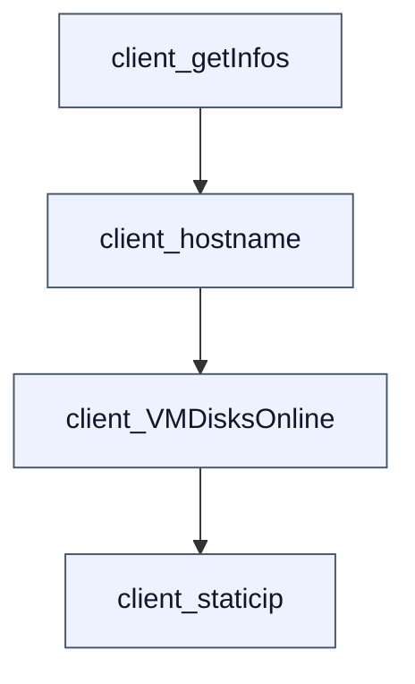
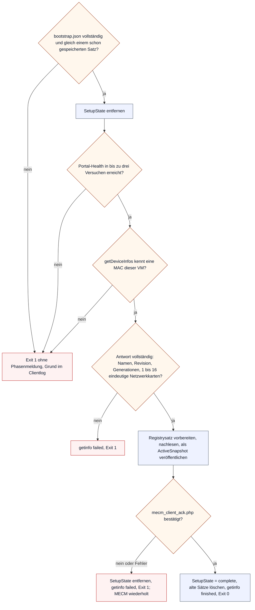
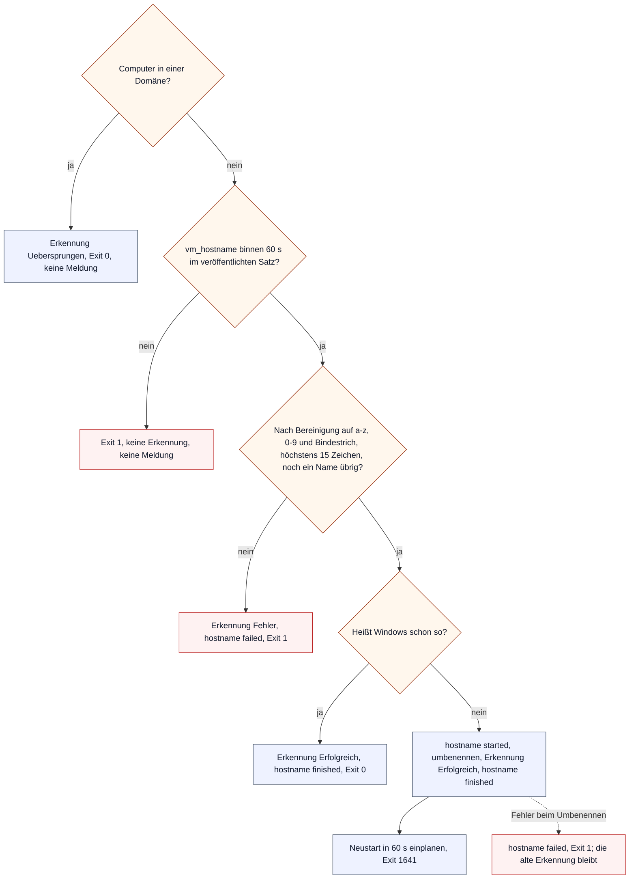
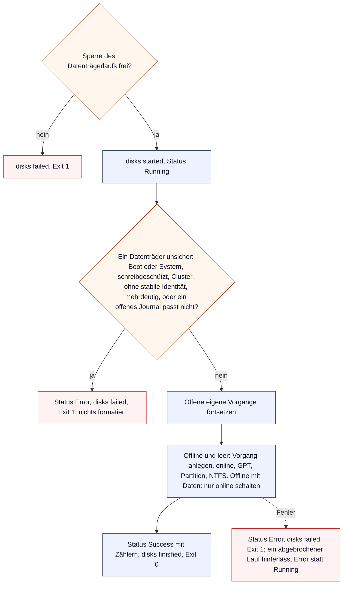
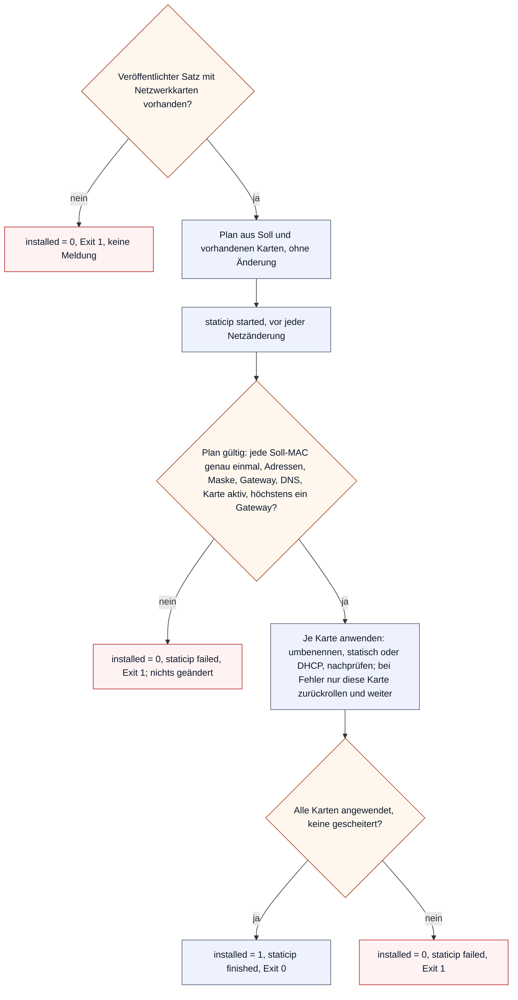
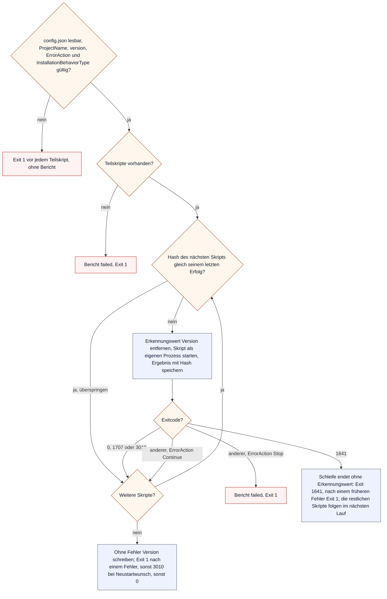
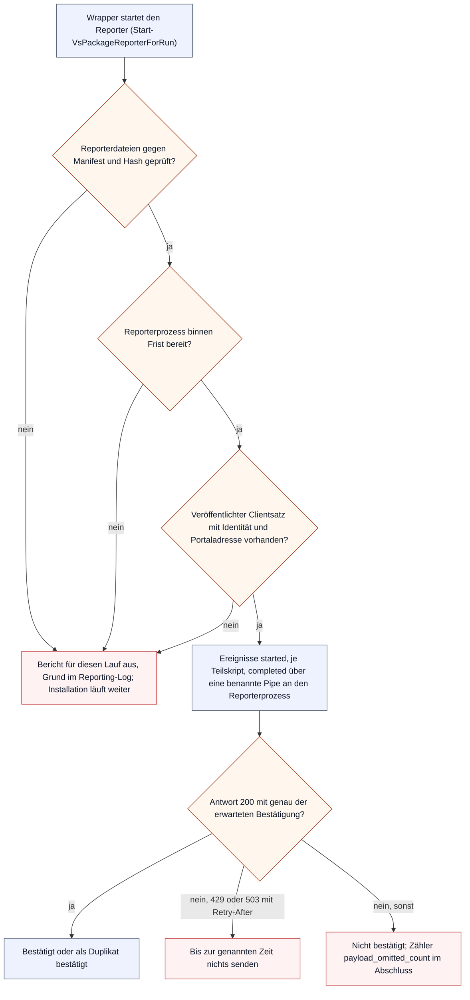

# Clientabläufe

Auf einer frisch installierten Windows-VM laufen zwei Arten VirtuSphere-Code, beide als MECM-Anwendungen: die vier Clientanwendungen, die die VM ans Portal anbinden, umbenennen, ihre Datenträger bereitstellen und ihr Netz setzen, und der Paketwrapper `install.ps1`, der jedes Softwarepaket ausführt und seinen Lauf über den Paketreporter meldet. Die Skripte liegen unter `Powershell-MECM/clients/` und `Powershell-MECM/Package_Vorlage/`. Was das Portal mit den Meldungen tut, zeigen die [Abläufe der Maschinen-API](machine-api-flows.md); wie eine VM dadurch ihre Phase wechselt, steht im [Lebenszyklus einer VM](vm-lifecycle.md). Einstieg: [Abläufe](flows.md).

Die Diagramme beschreiben den Code im Repository. Welcher Stand an einem Standort ausgerollt ist, entscheidet der Core-/Reporter-Cutover in der [MECM-Integration](mecm-integration.md); bis dahin kann dort noch der alte Graph laufen. Wer Reihenfolge, Erkennung oder Meldungen eines Skripts ändert, zieht dieses Dokument im selben Commit nach; `VirtuSphere.ClientFlowsDoc.Tests.ps1` leitet Anwendungen, Abhängigkeiten, Erkennungswerte und Phasen aus dem Code ab.

## Anwendungen und Reihenfolge

Die vier Clientanwendungen stehen als Datentabelle in `Get-VsClientAppSpecs` (`Powershell-MECM/mecm/VirtuSphere-ClientPackaging.ps1`). MECM führt sie über Anwendungsabhängigkeiten in dieser Reihenfolge aus; nur `client_staticip` wird verteilt, die drei anderen sind seine Abhängigkeiten. Eine Anwendung gilt als installiert, wenn ihr Erkennungswert in `HKLM` steht; das Skript schreibt ihn selbst und nur bei Erfolg.

| Anwendung | Rolle | Hängt ab von | Erkennung (Schlüssel, Wert, Inhalt) |
|---|---|---|---|
| `client_getInfos` | `internal_dependency` | – | `SOFTWARE\VirtuSphere`, `SetupState` = `complete` |
| `client_hostname` | `internal_dependency` | `client_getInfos` | `SOFTWARE\VirtuSphere\HostnameUpdate`, `Status` = `Erfolgreich` oder `Uebersprungen` |
| `client_VMDisksOnline` | `internal_dependency` | `client_hostname` | `SOFTWARE\VirtuSphere\VMDiskManagement`, `VMDisksOnlineStatus` = `Success` |
| `client_staticip` | `deployable_entry` | `client_VMDisksOnline` | `SOFTWARE\VirtuSphere\staticip`, `installed` = `1` |

Alle vier laufen höchstens 15 Minuten und melden MECM 0 als Erfolg, 1641 und 3010 als Erfolg mit Neustart; jeder andere Code ist ein Fehlschlag, den MECM wiederholt. Von den Skripten liefert nur `client_hostname` 1641, die übrigen enden mit 0 oder 1.

## client_getInfos

Bindet die VM ans Portal: liest die Adresse des Portals aus `bootstrap.json`, holt die Daten der VM über ihre MAC und veröffentlicht sie als Registrysatz, den die Folgephasen und der Paketreporter lesen. Erst der bestätigte Client-Ready-ACK macht die Anwendung „installiert“.

`Initialize-VsClientBootstrap` schreibt die Portaladresse nur, wenn der Registrysatz noch leer ist, und unter einer maschinenweiten Sperre; ein gleicher Satz bleibt, ein abweichender, halber oder ungültiger blockiert ohne Mischung und ohne DNS- oder IP-Ersatz. `Resolve-VsApi` prüft genau eine Adresse und nimmt nur eine Antwort im Health-Schema des Portals an. Jede MAC wird bis zu dreimal abgefragt, mit zehn Sekunden Pause nach einem Fehler. Bevor die VM bekannt ist, gibt es keine MAC, unter der eine Phasenmeldung ankäme; die ersten drei Abbrüche stehen deshalb nur im Clientlog. Der ACK (`Confirm-VsClientReady`) ist die einzige verbindliche Meldung der Kette; er kann beim Portal angekommen sein, obwohl seine Antwort verloren ging, und der Wiederholungslauf trifft dann auf den Duplikatzweig des Portals.

## client_hostname

Benennt Windows nach dem eingefrorenen Rollout-Hostnamen um.

`Set-MecmDetection` schreibt den Erkennungswert. `Uebersprungen` ist ein zweiter Erfolgswert, damit ein Domänencomputer nicht endlos wiederholt wird. Ein Name, den die Bereinigung verändert hat, wird mit Hinweis im Detail verwendet und ist kein Fehler. Die Meldung `finished` geht vor dem Neustart ab; ob sie ankommt, entscheidet das Netz.

## client_VMDisksOnline

Bringt zusätzliche Datenträger online und richtet leere ein. Ohne zusätzliche Datenträger ist nichts zu tun, und auch das ist ein Erfolg.

Jeder Vorgang an einem leeren Datenträger steht vorher in einem Journal unter `SOFTWARE\VirtuSphere\VMDiskManagement\Operations` und durchläuft die Schritte `intent`, `online`, `initialized`, `partitioned`, `formatted`, `complete`; nach jedem Schritt wird der Ist-Zustand zurückgelesen (`Invoke-OwnedRawDiskOperation`). Ein abgebrochener Lauf setzt beim nächsten Versuch an derselben Stelle fort. Ein Datenträger mit Daten wird nie formatiert, ein schon online stehender leerer ohne eigenes Journal ebenfalls nicht.

## client_staticip

Setzt die Netzwerkkarten nach dem veröffentlichten Satz: statische Adresse oder DHCP, Name der Karte nach dem VLAN.

`New-VsClientNetworkPlan` prüft alles, bevor eine Karte angefasst wird. Was das Skript selbst gesetzt hat, merkt es je MAC unter `SOFTWARE\VirtuSphere\staticip\Managed` und entfernt beim nächsten Lauf nur diese eigenen Adressen und Routen. Ein leeres DNS-Soll lässt die vorhandenen Server stehen. Die neue Adresse kann die Verbindung zum Portal trennen; `started` geht deshalb vor der Umstellung ab, `finished` ist ein Versuch. Die vNIC wechselt keine ESXi-Portgruppe.

## Phasenmeldungen

Die Clientanwendungen melden ihren Stand mit `Send-VsPhase` an `mecm_report.php?action=reportPhase`: eine Phase, ein Ereignis `started`, `finished` oder `failed`, ein kurzes Detail. Jede Meldung ist ein einzelner Versuch mit fünf Sekunden Frist; scheitert sie, steht das im Clientlog und das Skript läuft weiter. Ohne MAC aus dem veröffentlichten Satz oder einer aktiven Karte (`Get-VsReportMac`) wird nichts gemeldet. Die Meldungen sind Anzeige, kein Beleg; verbindlich ist allein der Client-Ready-ACK.

| Phase | Skript | `started` | `finished` | `failed` |
|---|---|---|---|---|
| `getinfo` | `client_getInfos` | nach dem MAC-Treffer | nach dem ACK | ungültige Antwort, Schreib- oder ACK-Fehler |
| `hostname` | `client_hostname` | nur vor einem Umbenennen | Name schon richtig oder umbenannt, vor dem Neustart | leerer Name nach Bereinigung, Fehler |
| `disks` | `client_VMDisksOnline` | nach der Sperre | Erfolg, auch ohne Arbeit | Sperre belegt, unsicherer Datenträger, Fehler |
| `staticip` | `client_staticip` | vor der Netzänderung | alle Karten angewendet | ungültiger Plan, eine Karte gescheitert |

## Paketwrapper

`install.ps1` ist der Einstieg jedes Softwarepakets. Er führt die Teilskripte unter `powershell\` in Namensreihenfolge aus, merkt sich je Skript den Hash seines letzten Erfolgs und setzt den Erkennungswert des Pakets nur, wenn alle Teilskripte durchliefen. Gesteuert wird er von `config.json`: `ProjectName` und `version` bilden den Registrypfad `Software\VirtuSphere\Packages\<ProjectName>-<version>`, `ErrorAction` (`Stop` oder `Continue`) entscheidet über den Abbruch nach einem Fehler, `InstallationBehaviorType` `InstallForUser` legt Registry und Logs beim Benutzer statt beim System ab. Ein leerer `InstallationBehaviorType` heißt `InstallForSystem`; ein anderer Wert bricht wie im Autoimporter ab, bevor Registry, Log oder ein Teilskript etwas tun.

Der Wrapper entfernt den Erkennungswert vor jedem Teilskript, das wirklich läuft; scheitert das Entfernen oder das Speichern des Ergebnisses, endet er mit Exit 1. Ein übersprungenes Skript fordert einen früheren Neustart nicht erneut an. Bei mehreren Ergebnissen gilt die Rangfolge Fehler vor 1641 vor 3010 vor 0, damit ein gescheitertes Paket nicht als „bitte neu starten“ erscheint. Die Logs liegen je Lauf unter `%ProgramData%\VirtuSphere\Logs`, bei `InstallForUser` unter `%LOCALAPPDATA%\VirtuSphere\Logs`; eine unsichere Logwurzel schaltet nur die Logs ab. `DeployTo`, `generateOwnDeviceColletion` und `removeOldVersion` liest der Autoimporter, nicht der Wrapper.

## Paketreporter

Der Paketreporter meldet einen Paketlauf als Diagnose an `mecm_report.php?action=reportPackageRun`: ein Ereignis `started`, eines je Teilskript und eines zum Abschluss. Er ändert nie das Ergebnis der Installation; sein aktives Zeitbudget beträgt zehn Sekunden je Lauf, und eine Überschreitung steht im Reporting-Log.

Der Reporter besteht aus einer reinen Bibliothek ohne Ein- und Ausgabe (`VirtuSphere-Package-Reporter.ps1`), die die Ereignisse baut und Antworten prüft (`Resolve-VsPackageReportAcknowledgement`), und einem eigenen Prozess (`VirtuSphere-Package-ReporterHost.ps1`, `Start-VsPackageReportPipeWorker`), der sendet (`Invoke-VsPackageReportHttp`). Jedes Ereignis hat genau einen Versuch mit höchstens zwei Sekunden Frist; es gibt keine Wiederholung und keine Pause. Gesendet wird ohne Weiterleitung, Proxy und Anmeldedaten; bei HTTPS mit hinterlegtem Fingerabdruck gilt nur dieses Zertifikat. Den Lauf ordnet das Portal über die MACs und die Generationen des veröffentlichten Satzes genau einer VM zu; was es prüft und speichert, steht im [Berichtskanal](machine-api-flows.md#berichtskanal).
