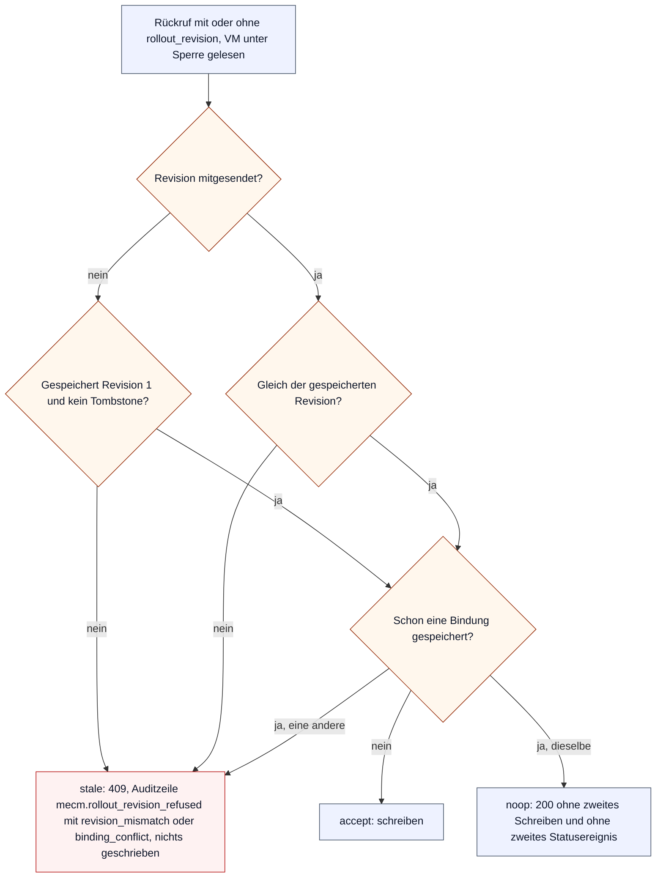
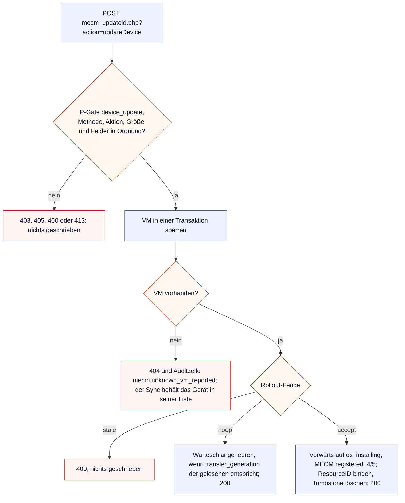
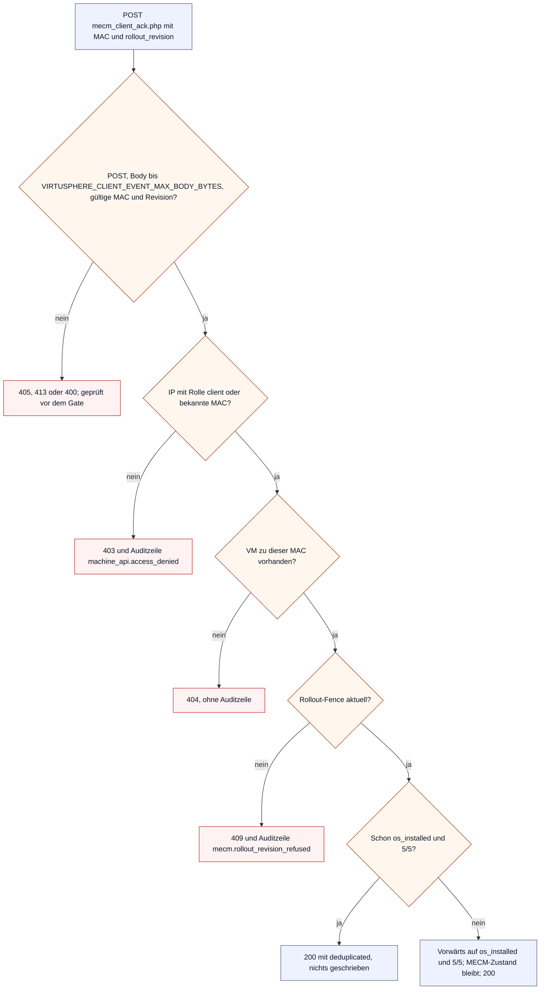
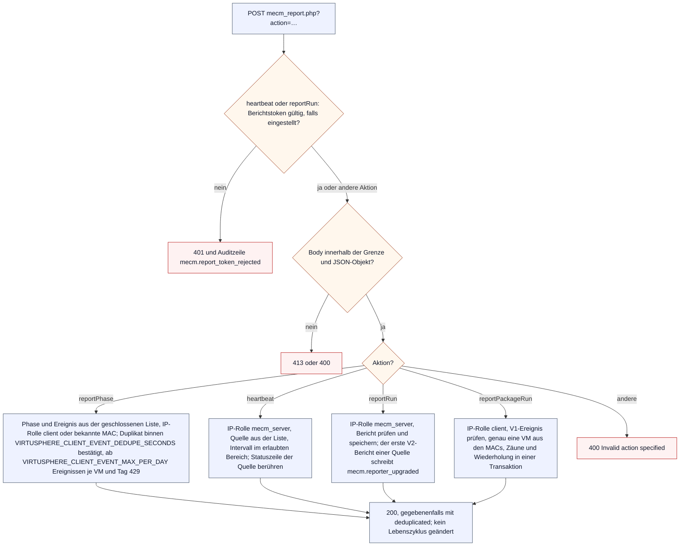
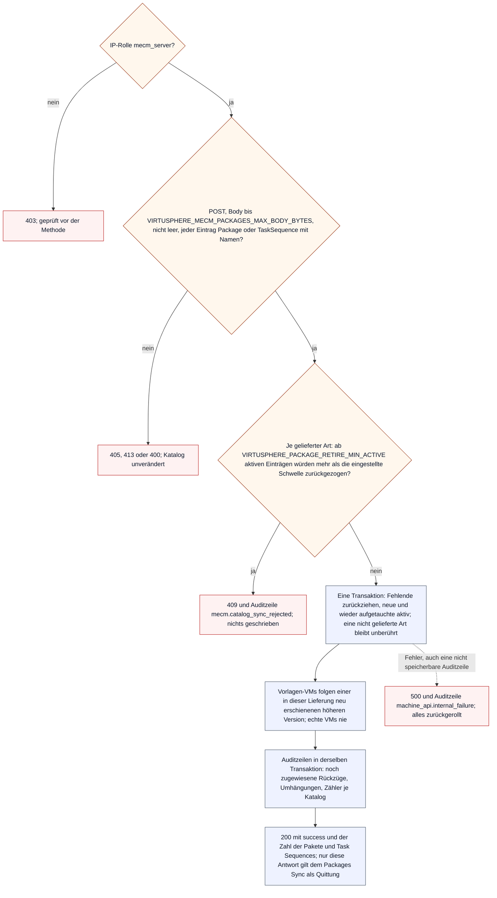

# Maschinen-API: Abläufe

Die Maschinen-API ist der Rückkanal von Ansible-Host, MECM-Server und Windows-Clients ins Portal. Ihre Endpunkte liegen als einzelne Dateien in `Docker/WebAPI/`, antworten nur mit JSON und sind ein eingefrorener Leitungsvertrag (ADR-0019, ADR-0035, ADR-0043, ADR-0044). Dieses Dokument zeigt, was die Serverseite mit einem Aufruf tut. Was die MECM-Serveraufgaben senden, steht in den [MECM-Serveraufgaben](mecm-scheduled-tasks.md), was die Clients senden, in den [Clientabläufen](client-flows.md); die Freigabeliste und ihre Rollen beschreibt die [MECM-Integration](mecm-integration.md). Einstieg: [Abläufe](flows.md).

Die Diagramme beschreiben den ausgelieferten Code. Wer einen Endpunkt, eine Aktion, ein Gate oder die Reihenfolge der Prüfungen ändert, zieht dieses Dokument im selben Commit nach; `MachineApiFlowsDocContractTest` leitet Endpunkte, Aktionen, Gates, Rollen und Fence-Ergebnisse aus dem Code ab.

## Endpunkte und Rollen

Jeder Eintrag der Freigabeliste trägt eine Rolle; ein Gate lässt nur IPs seiner Rollen durch (`machine_api_ip_allowed()`, Zuordnung in `VIRTUSPHERE_MACHINE_API_GATE_ROLES`). Ein Eintrag ohne Rolle (Bestand vor Migration 0063) öffnet weiter jedes Gate, bis ein Administrator eine Rolle setzt. Drei Clientwege nehmen statt der IP auch eine MAC an, die das Portal schon kennt (`machine_api_mac_allowed()`). Eine Ablehnung antwortet immer mit demselben 403-Text und schreibt eine gedrosselte Auditzeile `machine_api.access_denied` mit der Ursache `ip_not_allowlisted` oder `ip_role_not_permitted` (`machine_api_forbidden()`).

| Endpunkt | Aktion | Gate | Rolle | Bekannte MAC genügt | Schreibt |
|---|---|---|---|---|---|
| `db_importMAC.php` | `updateInterface` | `mac_import` | `ansible_host` | nein | MACs, Bindung und Zustand der VMs, Ergebnis des Auftrags |
| `deploy_vm_touch.php` | – | `vm_touch` | `ansible_host` | nein | nur das Journal des Auftrags (`esxi_touched`) |
| `mecm-api.php` | `getDeviceList` | `device_list` | `mecm_server` | nein | nichts |
| `mecm-api.php` | `getDeviceInfos` | `device_infos` | `client` | ja | nichts |
| `mecm_client_ack.php` | – | `client_ack` | `client` | ja | Lebenszyklus `os_installed`, Stufenwert 5/5 |
| `mecm_packages.php` | – | `package_catalog` | `mecm_server` | nein | Paket- und Betriebssystemkatalog |
| `mecm_report.php` | `reportPhase` | `client_phase` | `client` | ja | Clientereignis zur Anzeige |
| `mecm_report.php` | `heartbeat` | `server_report` | `mecm_server` | nein | Statuszeile der Quelle |
| `mecm_report.php` | `reportRun` | `server_report` | `mecm_server` | nein | Laufbericht der Serveraufgabe |
| `mecm_report.php` | `reportPackageRun` | `package_report` | `client` | nein | Diagnose eines Paketlaufs |
| `mecm_updateid.php` | `updateDevice` | `device_update` | `mecm_server` | nein | ResourceID, Lebenszyklus `os_installing`, MECM `registered`, Stufenwert 4/5 |
| `mecm_updateid.php` | `reportMembership` | `device_update` | `mecm_server` | nein | Herkunft der Collection-Mitgliedschaften |

`heartbeat` und `reportRun` verlangen zusätzlich den Berichtstoken im Kopf `X-VirtuSphere-Token`, sobald einer eingestellt ist (`machine_api_report_token_ok()`). Die übrigen Dateien in `Docker/WebAPI/` (`function.php`, `index.php`, `intern.php`, `mysql.php`) sind Einbindungen oder Weiterleitungen, keine Endpunkte. Die Liste der Endpunkte führt `VIRTUSPHERE_MACHINE_API_ENDPOINTS`.

## Rollout-Fence

Jeder Rückruf, der einen MECM- oder Clientzustand schreibt, nennt die Rollout-Revision, die er gelesen hat; `mecm_rollout_fence_decide()` entscheidet in derselben Transaktion wie das Schreiben (ADR-0043). So kann ein Rückruf aus einem früheren Rollout, etwa nach „MECM-ID zurücksetzen“, den neuen Rollout nicht überschreiben.

Eine fehlende Revision gilt nur für den Bestand vor dem Wechsel der Skripte als aktuell; eine vorhandene, aber unbrauchbare Revision ist 400, nicht 409 (`mecm_rollout_fence_reported_revision()`). Eine Revision aus der Zukunft wird ebenso abgelehnt wie eine alte. Bindung heißt bei `updateDevice` die ResourceID; `reportMembership` und `mecm_client_ack.php` binden nichts und kennen deshalb nur `accept` und `stale`. Welche Prüfung abgelehnt hat, steht nur in der Auditzeile (`mecm_rollout_fence_refusal_cause()`); die Antwort ist für beide Ursachen dieselbe.

## Geräte-Sync

Der Devices Sync liest `getDeviceList`: alle VMs mit `updated = 1` oder MECM-Zustand `pending`, nur mit MAC und nie aus einer Vorlagenmission, mit dem eingefrorenen Rollout-Hostnamen unter `vm_hostname` und dem Stufenwert, den `virtusphere_legacy_status_from_states()` bei jeder Abfrage aus den Achsen berechnet. Die Abfrage schreibt nichts. Was der Sync danach in MECM tut, zeigt [Devices Sync](mecm-scheduled-tasks.md#devices-sync); sein Rückruf ist `updateDevice`:

Der Lebenszyklus geht nur vorwärts (`repo_set_vm_state_forward()`): Eine VM, die schon `os_installed` meldet, behält ihn, ResourceID und MECM-Zustand werden trotzdem geschrieben. `updated` wird nur gelöscht, wenn der Rückruf die Übertragung beantwortet, die gerade ansteht (`mecm_transfer_generation_applied()`); ein Rückruf ohne `transfer_generation` beantwortet jede. Eine Ablehnung beantwortet der Endpunkt erst nach dem Ende der Transaktion, damit ein Erfolg seine eigene Schreibung nicht zurückrollt. `reportMembership` prüft bis zu `VIRTUSPHERE_MECM_RULE_REPORT_MAX_ENTRIES` Einträge vollständig, bevor er schreibt, durchläuft denselben Fence ohne Bindung und speichert nur die Herkunft der Mitgliedschaften (`repo_mecm_rules_apply_report()`). Ein unerwarteter Fehler ergibt 500 mit der Auditzeile `machine_api.internal_failure`.

## Client-Ready-ACK

`client_getInfos` liest seine Daten mit `getDeviceInfos` (ohne Schreibwirkung) und bestätigt nach dem Veröffentlichen seines Registrysatzes mit `mecm_client_ack.php`. Das ist der einzige Schreiber des Stufenwerts 5/5 (A63).

Der ACK lässt den MECM-Zustand und das Flag `updated` stehen; `registered` schreibt allein `updateDevice` (VT-E1 C). Kommt die Antwort beim Client nicht an, wiederholt MECM die Anwendung; der zweite ACK trifft dann auf den Zweig `deduplicated`.

## Berichtskanal

`mecm_report.php` nimmt Berichte entgegen, die nur angezeigt werden: Phasen der Clients, Lebenszeichen und Laufberichte der MECM-Serveraufgaben und Berichte des Paketwrappers. Er ändert nie den Lebenszyklus einer VM.

Die Grenze ist `VIRTUSPHERE_CLIENT_EVENT_MAX_BODY_BYTES`, für `reportPackageRun` `VIRTUSPHERE_PACKAGE_REPORT_MAX_BODY_BYTES`. Ein abgelehntes Gate ergibt 403. `reportPhase` prüft MAC, Phase und Ereignis vor dem Gate; eine unbekannte MAC ist 404. Duplikat, Tagesgrenze und Einfügen teilen sich eine Transaktion (`repo_client_event_record_once()`); eine erreichte Tagesgrenze schreibt eine je VM gedrosselte Auditzeile `mecm.client_event_cap_reached`. `reportRun` prüft den Bericht gegen die geschlossene Liste der Ursachen (`run_report_validate()`) und speichert ihn (`repo_record_run_report()`); einzelne Läufe werden nicht auditiert. `reportPackageRun` prüft das Ereignis (`package_run_report_validate()`), löst die MACs zu genau einer VM auf (`repo_package_report_resolve_vm()`) und speichert es (`repo_package_report_record()`); eine identische Wiederholung wird bestätigt, ohne Zeitstempel oder Ablauf zu erneuern, eine widersprüchliche abgelehnt. Paketberichte ändern weder Lebenszyklus noch Statuszeilen noch Katalog und schreiben keine Auditzeilen.

## Paketkatalog

Der Packages Sync schickt den ganzen Katalog: Pakete (`Package`) und Task Sequences (`TaskSequence`). `mecm_packages.php` zieht fehlende Einträge zurück, statt sie zu löschen, und bremst, wenn eine Lieferung zu viel zurückziehen würde.

Die Bremse (`packages_retire_guard()`) läuft vor jedem Schreiben. Die Schwelle ist die Einstellung `VIRTUSPHERE_SETTING_PACKAGE_RETIRE_THRESHOLD` (5 bis 90 %, Standard `VIRTUSPHERE_PACKAGE_RETIRE_THRESHOLD_DEFAULT`). Ein Paketname, den dieselbe Lieferung durch eine höhere Version desselben Pakets ersetzt, zählt nicht als Verlust (AV-R14). Ein zurückgezogenes Paket wird nicht gelöscht; das tut erst der [Wartungsdienst](maintenance-flows.md#aufbewahrung) nach Frist. Die Vorlagenregel (`packages_follow_first_versions_in_templates()`) zählt nur Einträge, die diese Lieferung neu angelegt hat; ein vorübergehend fehlender und wieder aufgetauchter Name bewegt nichts. Der Rückzug einer Version, die VMs noch tragen, erscheint einmal als Auditzeile mit der höheren aktiven Version als Arbeitsliste (`packages_audit_retired_assignments()`); verschoben wird dabei nichts.

## Rückrufe des Ansible-Hosts

Der Ansible-Host ruft zwei Endpunkte. `deploy_vm_touch.php` lässt eine VM für den nächsten ESXi-Zugriff von Power-Cycle oder Export zu: Der geschlossene Request `{job_id, vm_id, attempt, generation, phase}` muss zum aktiven Auftrag, seinem Versuch, der Laufzeitgeneration, dem Umfang und einem Playbook des Modus passen (`repo_deploy_job_vm_touch_refusal()`). Dann setzt er nur die Markierung im Journal; eine Ablehnung ist 409 mit einer Ursache aus `VIRTUSPHERE_DEPLOY_TOUCH_REFUSAL_CAUSES` und einer gedrosselten Auditzeile `machine_api.touch_refused`, und das Playbook bricht vor der ESXi-Abfrage dieser VM ab. `db_importMAC.php` nimmt das MAC-Ergebnis des Exports an; unter Sperre von Mission, Auftrag und Laufzeit entscheidet er, ob der Auftrag (`running` oder `cancelling`) es noch annehmen darf, und schreibt MACs, VM-Zustand und Ergebnis in einer Transaktion. Eine identische Wiederholung bekommt die gespeicherte Antwort; eine Ablehnung ist 409 mit einem Code aus `VIRTUSPHERE_MAC_IMPORT_CALLBACK_REASON_META`. Was der Worker aus dem Ergebnis macht, steht im Diagramm [„Worker: ein Auftrag“](deploy-flows.md#worker-ein-auftrag), was die VM danach zeigt, im [Lebenszyklus einer VM](vm-lifecycle.md).
