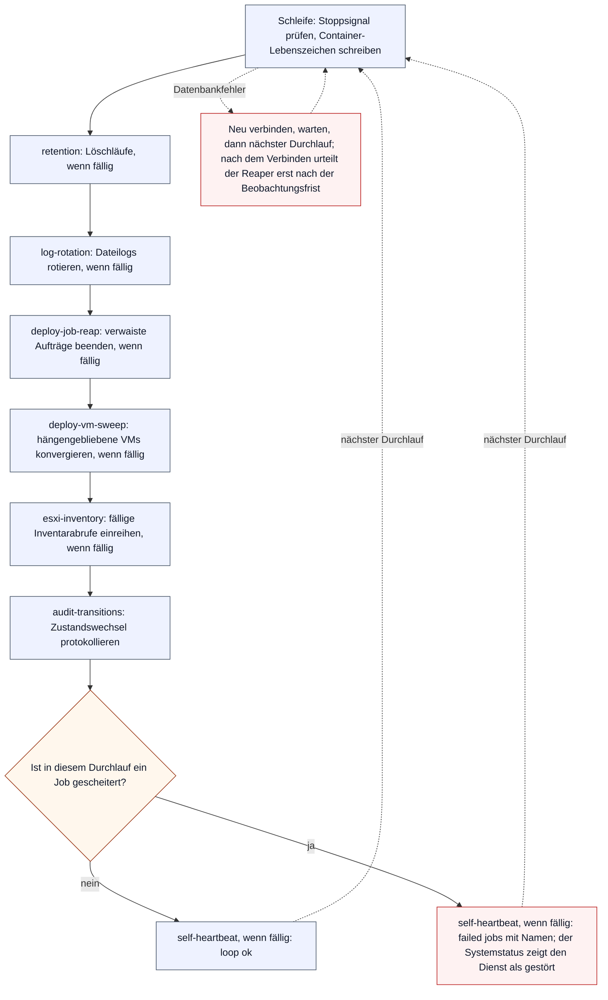
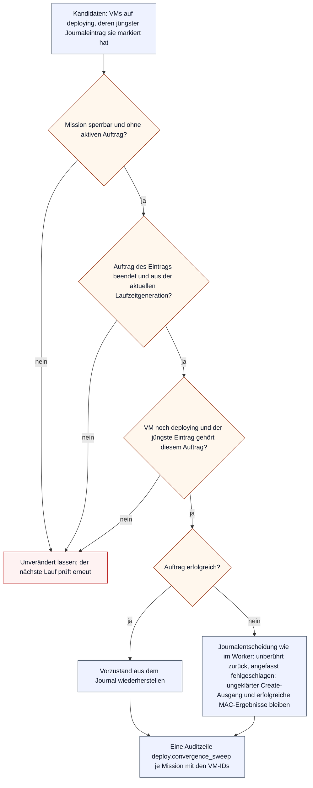

# Wartungsdienst: Abläufe

Der Wartungsdienst (`maintenance-worker`, ADR-0018) ist der zweite Schleifencontainer neben dem Bereitstellungsdienst. Er räumt nach Aufbewahrungsfristen auf, beendet verwaiste Aufträge, bringt hängengebliebene VMs in einen benannten Zustand, reiht fällige Inventarabrufe ein und protokolliert Zustandswechsel der Integrationsquellen. Die Schleife steht in `Docker/WebAPI/lib/maintenance_worker.php`, die Jobs in `Docker/WebAPI/lib/maintenance_tasks.php`. Einstieg: [Abläufe](flows.md).

Die Diagramme beschreiben den ausgelieferten Code. Wer einen Job hinzufügt, entfernt, umbenennt oder seinen Takt ändert, zieht die Tabellen und das Diagramm im selben Commit nach; `MaintenanceFlowsDocContractTest` leitet Jobs, Takte und Löschläufe aus dem Code ab.

## Jobs und Takt

Ein Durchlauf startet alle `VIRTUSPHERE_MAINTENANCE_WORKER_SLEEP_SECONDS` Sekunden (`--sleep=N` überschreibt den Wert, 1 bis 60). Jeder Job hat einen eigenen Takt und läuft nur, wenn er fällig ist (`maintenance_worker_due()`); die Fälligkeit lebt im Prozess und beginnt nach einem Neustart von vorn, sodass der erste Durchlauf alle Jobs ausführt. `--once` führt jeden Job genau einmal aus.

| Job | Takt | Konstante | Arbeit |
|---|---|---|---|
| `self-heartbeat` | 60 s | `VIRTUSPHERE_MAINTENANCE_HEARTBEAT_INTERVAL_SECONDS` | Ergebnis des Durchlaufs in die eigene Statuszeile schreiben (`repo_record_worker_result()`), immer am Ende des Durchlaufs |
| `retention` | 3600 s | `VIRTUSPHERE_MAINTENANCE_RETENTION_INTERVAL_SECONDS` | Löschläufe der Aufbewahrungsfenster (`maintenance_worker_retention()`, Tabelle unten) |
| `log-rotation` | 3600 s | `VIRTUSPHERE_MAINTENANCE_LOG_ROTATION_INTERVAL_SECONDS` | Dateilogs rotieren, die die Datenbankaufbewahrung nicht erfasst (`virtusphere_rotate_logs()`) |
| `deploy-job-reap` | 120 s | `VIRTUSPHERE_DEPLOY_REAP_INTERVAL_SECONDS` | Aufträge mit veraltetem Herzschlag beenden (`deploy_worker_reap_stale_jobs()`, Ablauf in [„Aufsicht: verwaiste Aufträge“](deploy-flows.md#aufsicht-verwaiste-aufträge)) |
| `deploy-vm-sweep` | 300 s | `VIRTUSPHERE_DEPLOY_VM_SWEEP_INTERVAL_SECONDS` | VMs konvergieren, die nach dem Ende ihres Auftrags noch `deploying` stehen (`repo_sweep_orphaned_deploying_vms()`, Abschnitt unten) |
| `esxi-inventory` | 300 s | `VIRTUSPHERE_ESXI_INVENTORY_SCHEDULE_CHECK_SECONDS` | Fällige Inventarabrufe einreihen (`esxi_inventory_enqueue_due()`, Regeln im [ESXi-Inventar](esxi-inventory.md)) |
| `audit-transitions` | jeder Durchlauf | | Zustandswechsel der Integrationsquellen protokollieren (`maintenance_worker_audit_transitions()`, Abschnitt unten) |

## Ein Durchlauf

Die Jobs sind voneinander unabhängig. Wirft einer, hält `maintenance_worker_job()` seinen Namen fest und der Durchlauf geht weiter; ein gescheiterter Löschlauf hält den Reaper also nicht auf. Erst am Ende entscheidet die Liste der gescheiterten Jobs über das Urteil, das der Systemstatus zeigt (`maintenance_worker_run_once()`).

Das Lebenszeichen steht bewusst am Ende: Ein Durchlauf, der bei jedem Takt wirft, meldet sich so nicht mehr grün. Ein Datenbankfehler (`mysqli_sql_exception`) bricht den Durchlauf ab; die Schleife verbindet neu (`maintenance_worker_connect_db()`), wartet `--sleep` und versucht es erneut, statt in einer schnellen Schleife zu kreisen. Jede neue Verbindung setzt den Beobachtungsbeginn des Reapers (`deploy_reap_observer_since()`), damit er die Zeit ohne Datenbank nicht als toten Worker deutet. Ein Stoppsignal beendet den Dienst nur zwischen zwei Durchläufen oder während des Wartens (`worker_stop_requested()`).

## Aufbewahrung

Jeder Löschlauf ist ein eigener Job namens `retention:<Name>`; ein gescheiterter Löschlauf erscheint mit diesem Namen im Urteil, die übrigen laufen weiter. Hat ein Lauf etwas gelöscht, schreibt `retention:audit` eine einzige Auditzeile `system.retention_purged` mit allen Zählern. Kann sie nicht gespeichert werden, ist der Job gescheitert; die Löschungen sind dann schon festgeschrieben.

| Löschlauf | Funktion | Fenster |
|---|---|---|
| `retention:portal_logs` | `removeLog()` | Sicherheitskategorien `VIRTUSPHERE_LOG_RETENTION_SECURITY_DAYS`, übrige Kategorien `VIRTUSPHERE_LOG_RETENTION_DAYS` (ADR-0026) |
| `retention:client_events` | `repo_purge_client_events()` | `VIRTUSPHERE_CLIENT_EVENT_RETENTION_DAYS` |
| `retention:login_attempts` | `repo_purge_login_attempts()` | `VIRTUSPHERE_LOGIN_ATTEMPT_RETENTION_DAYS` |
| `retention:retired_packages` | `repo_purge_retired_packages()` | `VIRTUSPHERE_PACKAGE_PURGE_AFTER_DAYS` nach dem Rückzug; nur ohne Zuweisung und nur, wenn die Zuweisungen nie umgehängt wurden |
| `retention:retired_os` | `repo_purge_retired_os()` | `VIRTUSPHERE_PACKAGE_PURGE_AFTER_DAYS` nach dem Rückzug; nur, wenn keine VM das Betriebssystem trägt |
| `retention:job_log_lines` | `repo_purge_deploy_job_logs()` | `VIRTUSPHERE_DEPLOY_JOB_LOG_RETENTION_DAYS` nach dem Ende des Auftrags; nie bei einer noch offenen Create-Einheit |
| `retention:finished_system_jobs` | `repo_purge_finished_system_jobs()` | `VIRTUSPHERE_SYSTEM_JOB_RETENTION_DAYS` nach dem Ende des Systemauftrags |
| `retention:status_events` | `repo_purge_vm_status_events()` | `VIRTUSPHERE_STATUS_EVENT_RETENTION_DAYS` |
| `retention:package_report_runs` | `repo_purge_expired_package_runs()` | Ablauf des Markers, beim ersten Bericht auf `VIRTUSPHERE_PACKAGE_REPORT_RETENTION_DAYS` gesetzt (ADR-0044) |
| `retention:audit` | `audit_event()` | eine Auditzeile je Lauf mit Löschungen |

## Hängengebliebene VMs

Der Konvergenzlauf deckt den Fall ab, den weder der Bereitstellungsdienst noch der Reaper erreicht: Der Auftrag ist schon beendet, eine VM steht aber noch auf `deploying`, etwa weil der Worker zwischen Endstatus und VM-Schreiben starb. Er handelt nur mit dem Journal des Auftrags (`deploy_job_vm_states`) als Vollmacht; eine alte VM ohne Journaleintrag fasst er nicht an.

Jede VM wird in einer eigenen Transaktion entschieden, in der Sperrreihenfolge Mission, Auftrag, Laufzeit, Create-Ergebnisse, VM. Wiederherstellen und Anwenden sind dieselben Funktionen, die der Worker beim Abbruch und beim Fehlschlag benutzt (`deploy_worker_restore_locked_vm_journal()`, `deploy_worker_apply_locked_vm_journal()`); was die VM danach zeigt, steht im [Lebenszyklus einer VM](vm-lifecycle.md#lebenszyklus). Scheitert nur die Auditzeile, bleibt die Konvergenz bestehen und das Containerlog nennt den Fehler.

## Zustandswechsel der Dienste

`audit-transitions` liest in jedem Durchlauf die Zeilen des Systemstatus (`repo_integration_status_rows()`) und vergleicht jede Quelle mit dem Zustand, den der Dienst zuletzt gesehen hat (`maintenance_worker_record_transitions()`). Protokolliert wird nur ein Wechsel, an dem ein Problemzustand beteiligt ist; das Pendeln zwischen `ok` und `legacy` während eines Skriptwechsels zählt nicht. Ein Wechsel zu einem Problemzustand ergibt eine Auditzeile `integration.state_changed` mit Ergebnis `warning`, die Rückkehr nach `ok` oder `legacy` eine mit `recovered`. Der gesehene Zustand wird erst nach gespeicherter Auditzeile übernommen; scheitert das Speichern, sieht der nächste Durchlauf denselben Wechsel noch einmal und der Durchlauf gilt bis dahin als gescheitert. Nach einem Neustart kennt der Dienst keinen früheren Zustand und protokolliert im ersten Durchlauf nichts.
