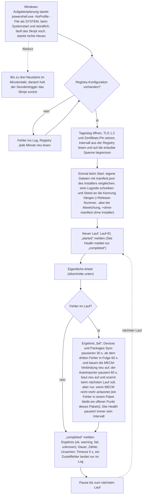
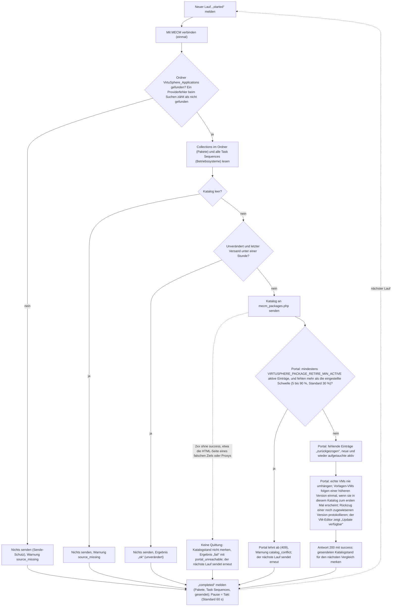
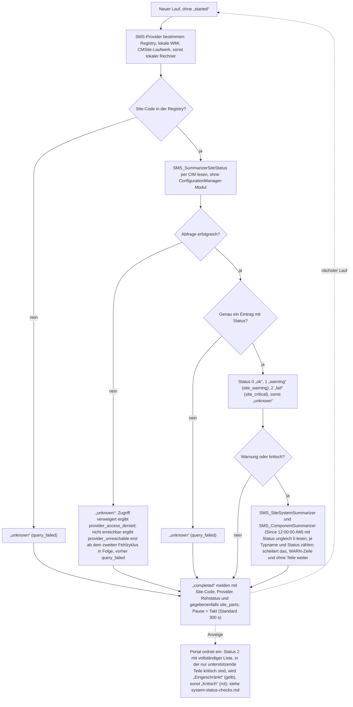

# MECM-Serveraufgaben: Abläufe

Die vier geplanten Aufgaben, die `Powershell-MECM/install-VirtuSphere-MECM.ps1` auf dem MECM-Server einrichtet, als Ablaufdiagramm. Installation, Registry-Werte, Überwachung und Fehlersuche stehen in der [MECM-Integration](mecm-integration.md); dieses Dokument zeigt nur, was die Skripte in welcher Reihenfolge tun.

Die Diagramme beschreiben den ausgelieferten Code. Wer den Ablauf eines der vier Skripte ändert (Reihenfolge, Verzweigung, Meldung), zieht das zugehörige Diagramm im selben Commit nach. Beschlossene, noch nicht gelieferte Änderungen stehen in den Plänen unter `docs/audits/`, nicht hier.

| Aufgabe | Skript | Takt (Standard, Spanne) | Registry-Wert | Tageslog |
|---|---|---|---|---|
| VirtuSphere MECM Devices Sync | `mecm_new-device-sync.ps1` | 10 s, 5 bis 3600 | `DeviceSyncIntervalSeconds` | `JJJJ-MM-TT_device-sync.log` |
| VirtuSphere MECM Packages Sync | `mecm_Packages-TaskSeq-sync.ps1` | 60 s, 10 bis 3600 | `PackagesSyncIntervalSeconds` | `JJJJ-MM-TT_packages-sync.log` |
| VirtuSphere MECM Package Import | `mecm_autoimporter.ps1` | 60 s, 30 bis 3600 | `ImporterIntervalSeconds` | `JJJJ-MM-TT_autoimporter.log` |
| VirtuSphere MECM Site Health | `mecm_site-health.ps1` | 300 s, 60 bis 3600 | `SiteHealthIntervalSeconds` | `JJJJ-MM-TT_site-health.log` |

Die Tageslogs liegen unter dem Registry-Wert `LogRoot` (Standard `C:\Program Files\VirtuSphere\Logs`) und bleiben 30 Tage. Jede Aufgabe meldet ihren Lauf an `mecm_report.php?action=reportRun`; das Portal zeigt ihn unter Systemstatus. Was der Endpunkt mit dem Bericht tut, steht im [Berichtskanal](machine-api-flows.md#berichtskanal).

## Gemeinsamer Rahmen

Alle vier Skripte sind Endlosschleifen mit demselben Rahmen. Die Abschnitte darunter zeigen jeweils nur die eigentliche Arbeit eines Laufs.

## Devices Sync

Trägt VMs aus der Warteschlange des Portals in MECM ein und setzt ihre Mitgliedschaften in OS-, Paket- und Missions-Collections. In der Warteschlange stehen neue VMs vor dem Rollout und VMs, deren Zuweisungen jemand an MECM übertragen hat. Jede Mitgliedschaftsänderung steht vorher im Journal, damit ein Absturz nichts Unklares hinterlässt.

```mermaid
flowchart TD
  L["Einmal beim Start: Mitgliedschafts-Journal für die ganze Laufzeit sperren"] --> LJ{"Sperre und Journal in Ordnung?"}
  LJ -->|nein| LX["Skript endet ohne MECM-Änderung und ohne Meldung ans Portal (Ursache nur im Serverlog); die Aufgabenplanung startet es neu. Liegt eine Journal-Quarantäne vor, endet jeder Neustart genauso, bis sie geklärt ist"]
  LJ -->|ja| S["Neuer Lauf, „started“ melden"]
  S --> Q["Warteschlange holen (getDeviceList): neue VMs und zur Übertragung markierte"]
  Q --> QE{"Warteschlange leer?"}
  QE -->|ja| R
  QE -->|nein| DUE{"Eine VM fällig? Gesperrte VMs nur bei geänderter Portalzeile oder nach dem Wiederholungstakt $script:VsDeviceRecheckSeconds"}
  DUE -->|nein| DUE1["Keine MECM-Abfrage; die Ursachen der gesperrten VMs gehen in den Laufbericht"] --> R
  DUE -->|ja| M["Mit MECM verbinden (einmal), alle Geräte, Task Sequences und Device Collections lesen; ein Gerät gilt unter jeder seiner MACs, auch wenn MECM sie als einen Text liefert; je Task Sequence eine Collection anlegen"]
  M --> V
  subgraph JE["Je VM in der Warteschlange"]
    V{"Mission und genau eine Netzwerkkarte auf der WDS-Portgruppe mit MAC?"}
    V -->|nein| V1["VM übersprungen, bleibt in der Warteschlange und gilt als gesperrt"]
    V -->|ja| MC["Mission-Collection anlegen, falls sie fehlt"]
    MC --> ID{"Identität eindeutig? (Rolloutname, PXE-MAC, ResourceID; eine gebundene ResourceID passt auf jede Portal-MAC der VM)"}
    ID -->|nein| ID1["Keine Änderung, VM bleibt mit Ursache in der Warteschlange und gilt als gesperrt"]
    ID -->|ja| G{"Gerät schon in MECM?"}
    G -->|nein| IMP["Rolloutname und MAC importieren und nachlesen; nicht sichtbar oder Fehler: VM wartet auf den nächsten Lauf"]
    IMP -->|importiert| RID
    G -->|ja| RID["ResourceID lesen; fehlt sie: nächster Lauf"]
    RID --> J{"Offene Einträge im Mitgliedschafts-Journal?"}
    J -->|ja| J1["Erst nachmelden; unklare Einträge bleiben zur Klärung stehen; VM wartet auf den nächsten Lauf"]
    J -->|nein| PL["Plan: Soll (OS-, Paket-, Missions-Collection) gegen eigene und vorhandene Regeln"]
    PL --> SE{"Soll eindeutig, eigene Regeln mit gültiger Provenienz?"}
    SE -->|nein| SE1["Keine Änderung, VM bleibt in der Warteschlange (membership_identity_ambiguous, membership_provenance_invalid)"]
    SE -->|ja| RD{"Mitgliedschaften lesbar?"}
    RD -->|nein| RD1["Keine Änderung, VM bleibt in der Warteschlange (membership_query_failed)"]
    RD -->|ja| AP["Fehlende Direktregeln hinzufügen, eigene, nicht mehr gewünschte entfernen; jede Änderung steht vorher im Journal; fehlt eine Collection: collection_missing"]
    AP --> RM["Änderungen melden (reportMembership); nur eine Antwort mit success quittiert und löscht den Journaleintrag; abgelehnt oder ohne success (etwa die HTML-Seite eines falschen Ziels oder Proxys mit Status 200): Eintrag bleibt, VM bleibt in der Warteschlange"]
    RM --> OK{"Alle Zuweisungen gesetzt?"}
    OK -->|nein| OK1["ResourceID nicht melden, VM bleibt in der Warteschlange"]
    OK -->|ja| UD["ResourceID und Übertragungszähler melden (updateDevice): das Portal bindet die ResourceID, setzt „registriert“ und nimmt die VM aus der Warteschlange; wurde sie während des Laufs erneut übertragen, bleibt sie für den nächsten Lauf drin"]
    UD -.->|abgelehnt oder Antwort ohne success| UD1["Warnung resource_update_failed, bei überholter Rollout-Revision stale_rollout_revision; VM bleibt in der Warteschlange"]
  end
  UD --> CU["Aktualisierung geänderter Collections anstoßen"]
  CU --> R["„completed“ melden (empfangen, importiert, Fehler, Warnungen)"]
  R --> DC{"Ursache je VM: Stand seit der letzten Quittung geändert oder diese älter als 5 Minuten, und keine Versandpause?"}
  DC -->|nein| P["Pause = Takt (Standard 10 s)"]
  DC -->|ja| DS["Ursache je VM melden (reportDeviceCauses): je VM die erste gerätebezogene Ursache ihres Durchgangs mit VM-ID und Rollout-Revision ihrer Zeile, gesperrte und nicht fällige VMs aus dem gespeicherten Sperrzustand; complete nur nach einem Lauf ohne Fehler über die ganze Warteschlange; höchstens 500 VMs, sonst complete=false; Zustellfehler nur im Log, nach 400, 404 oder 413 ruht der Versand 15 Minuten; das Laufergebnis bleibt unberührt"]
  DS --> P
  P -.->|nächster Lauf| S
```

Die Ursache je VM ist ein eigener Anzeigekanal neben dem Laufbericht. Gepaart wird am Abschnitt einer VM: Ursachen, die nur eine Collection betreffen (Ordner, Task-Sequence-Collections, Collection-Aktualisierung), gehen nicht in den Bericht. Ein Lauf, der vor dem Ende abbricht, meldet nur die schon gesammelten Ursachen mit complete=false; ohne Ursache sendet er nichts. Den gesendeten Stand merkt sich das Skript erst, wenn das Portal mit `success` und derselben Lauf-ID quittiert.

## Packages Sync

Meldet dem Portal den MECM-Katalog: Jede Device Collection im Ordner `VirtuSphere_Applications` ist ein Paket, jede Task Sequence ein Betriebssystem. Gesendet wird nur bei Änderung oder spätestens stündlich. Das Portal zieht fehlende Einträge zurück, löscht sie aber nicht; der Wartungsdienst entfernt zurückgezogene Pakete erst nach `VIRTUSPHERE_PACKAGE_PURGE_AFTER_DAYS` Tagen und nur, wenn keine VM sie mehr nutzt und ihre Zuweisungen nie umgehängt wurden; ein Paket, dessen Zuweisungen einmal automatisch auf eine höhere Version umgehängt wurden (etwa bei Vorlagen-VMs), bleibt dauerhaft stehen. Echte VMs hängt das Portal nie selbst um. Wie das Portal die Lieferung annimmt, zeigt der [Paketkatalog](machine-api-flows.md#paketkatalog) der Maschinen-API.

## Package Import (Autoimporter)

Macht aus den Paketordnern unter `files` mit ihrer `config.json` MECM-Applications samt Deployment Type, mit `generateOwnDeviceColletion` auch Collection und Deployments. Die Verteilung an die DPs übernimmt MECM: Der Autoimporter fordert sie je neuem Dateimanifest höchstens einmal an und zeigt den Stand nur an (AV2). Voll gescannt wird nur, wenn sich Dateien unter `files` oder `Package_Vorlage` geändert haben. Offene Punkte halten den Dateistand nicht mehr zurück (AR1): Jedes Paket mit offenen Punkten steht mit seinen Ursachen in einer Wiederholliste und wird allein erneut bearbeitet, wenn sein Termin fällig ist. Vorübergehende Ursachen wiederholt der Autoimporter nach dem Takt, danach mit doppeltem Abstand bis höchstens eine Stunde; was nur eine Änderung in MECM behebt (fehlende oder mehrdeutige `DeployTo`-Collection, Definitionsdrift), gleich nach einer Stunde; was nur eine Dateiänderung behebt (ungültige `config.json`, `DeployTo` auf die eigene Collection), gar nicht, denn die Dateiänderung löst ohnehin einen Vollscan aus. Jeder Lauf meldet alle offenen Punkte der Liste, auch ein ruhiger. Die Liste lebt im Prozess; nach einem Neustart scannt der erste Lauf voll. Die Prüfsumme liest nur neue oder geänderte Dateien (AL1): Der laufende Prozess merkt sich den Hash je Datei unter Pfad, Größe, Änderungszeit und NTFS-ChangeTime, die auch eine zurückgesetzte Änderungszeit verrät. Dateien, die in den letzten zwei Minuten geschrieben wurden, werden nie gemerkt, jeder Eintrag verfällt nach 12 bis 24 Stunden, und der erste Lauf nach einem Neustart der Aufgabe hasht alles. Die Paketprüfsummen des Scans nutzen denselben Speicher; eine gerade geschriebene Datei liest ein Lauf trotzdem nur einmal, weil er ihren Hash bis zum Laufende behält.

```mermaid
flowchart TD
  V{"Beim Start: Common-Vertrag passt?"} -->|nein| V1["Abbruch: Ordner Powershell-MECM vollständig bereitstellen, Installer mit -Upgrade -ServerOnly ausführen"]
  V -->|ja| SH{"Paketshare (UNC) konfiguriert?"}
  SH -->|nein| SH1["Warten, Registry jede Minute neu lesen"] --> SH
  SH -->|ja| S["Neuer Lauf, „started“ melden"]
  S --> M["Mit MECM verbinden (einmal), Ordner VirtuSphere_Applications anlegen, falls sie fehlen"]
  M --> H["Prüfsumme über files und Package_Vorlage bilden: nur neue oder geänderte Dateien hashen (Pfad, Größe, Änderungszeit, ChangeTime), sonst gemerkten Hash nehmen; jünger als 2 Minuten nie merken, aber bis Laufende behalten; Einträge verfallen nach 12 bis 24 h, erster Lauf nach Neustart hasht alles"]
  H -.->|Datei ändert sich währenddessen| HX["Lauf „warning“ (source_changing), Dateistand verwerfen, MECM-Verbindung bleibt, nächster Lauf prüft erneut"]
  H --> C{"Dateien geändert oder ein Paket der Wiederholliste fällig?"}
  C -->|nein| C1["Kein Scan (unverändert): offene Punkte der Wiederholliste und Verteilhinweise weiter melden, mit offenen Punkten „warning“; Verteilstand höchstens alle 30 Minuten lesend auffrischen"] --> R
  C -->|ja| B{"Ordner files vorhanden?"}
  B -->|nein| B1["Warnung source_missing, Dateistand nicht merken"] --> R
  B -->|ja| RC["Alle config.json lesen (ungültige sind offene Punkte bis zur nächsten Dateiänderung; DeployTo muss eine Zeichenkette ohne Randleerraum und Wildcards sein), je Produkt die höchste Version bestimmen. Bei geänderten Dateien jedes Paket bearbeiten, sonst nur die fälligen der Wiederholliste"]
  RC --> T
  subgraph JP["Je bearbeitetem Paketordner, mit eigenem Fehlerrahmen"]
    T["Vorlage (install.ps1, Reporter) ins Paket kopieren, wenn sie abweicht; eine Altvorlage ohne reporting-Ordner gleicht bis zum Cutover nur install.ps1 ab"]
    T -.->|nicht kopierbar| T1["Paket übersprungen, offener Punkt package_template_failed"]
    T --> AM{"Applicationname eindeutig?"}
    AM -->|nein, mehrere| AM1["Paket übersprungen, keine Definition und kein Content verändert, offener Punkt package_definition_drift"]
    AM -->|ja| A{"Application Name-Version vorhanden?"}
    A -->|nein| A1["Application (Marker) und Deployment Type anlegen: install.ps1, Erkennung per Registry-Schlüssel der Version"] --> DT
    A1 -.->|Deployment Type scheitert| A2["Application wieder entfernen; das Paket endet mit package_scan_failed"]
    A -->|ja| DT{"Genau ein Deployment Type, Identität lesbar?"}
    DT -->|nein| DT1["Paket übersprungen, offener Punkt"]
    DT -->|ja| FA{"Gespeicherter Auftrag nennt eine andere Identität (Application neu angelegt), und sie hat weder VirtuSphere-Marker noch liegt sie in VirtuSphere_Applications?"}
    FA -->|ja, fremd| FA1["Paket übersprungen: kein Content, kein Deployment, offener Punkt package_definition_drift"]
    FA -->|nein| CR{"Neues Dateimanifest, oder noch kein von MECM angenommener Auftrag?"}
    CR -->|ja| CR1["Höchstens ein Auftrag je Manifest: Erstverteilung an die DP-Gruppe oder neue Contentversion; nicht angenommen oder keine DP-Gruppe: offener Punkt package_content_request_failed"] --> TR
    CR -->|nein| TR["Verteilstand nur lesen: Fehler oder laufende Kopie auf DPs ist ein Hinweis, kein offener Punkt; DPs sperren nichts"]
    TR --> CO["Nur mit generateOwnDeviceColletion: Collection Name-Version und Deployment „Erforderlich“ anlegen; Fehlendes nachziehen. Ohne das Feld entsteht keine Collection, und das Paket fehlt im Portalkatalog, weil der Packages Sync nur Collections liest"]
    CO --> DD{"DeployTo gesetzt? Exakt in MECM prüfen (Device- oder User-Collection)"}
    DD -->|eigene Collection| DD1["Kein Deployment „Verfügbar“, offener Punkt package_deployto_invalid, keine Wiederholung bis zur Dateiänderung"]
    DD -->|fehlt| DD2["Kein Deployment, offener Punkt package_deployto_missing mit Collection-Name, Wiederholung nach einer Stunde"]
    DD -->|mehrere gleichnamig| DD3["Kein Deployment, offener Punkt package_deployto_ambiguous"]
    DD -->|vorhanden| DD4["Deployment „Verfügbar“ anlegen, wenn es fehlt; scheitert es: package_deploy_failed"]
    DD -->|nein| RO
    DD1 --> RO
    DD2 --> RO
    DD3 --> RO
    DD4 --> RO{"removeOldVersion und höchste Version?"}
    RO -->|ja| RO1["Bereinigungsplan zweimal lesen; bereit (Ersatzauftrag angenommen, Verteilung begonnen, Deployment geprüft; DP-Stand egal): Deployments, Applications und Collections älterer Versionen löschen; gesperrt: offener Punkt"]
    RO -->|nein| PE
    RO1 --> PE["Ergebnis in die Wiederholliste: mit Ursachen offen samt nächstem Termin, ohne Ursachen behoben"]
  end
  A2 --> PX
  JP -.->|unerwarteter MECM-Fehler| PX{"Antwortet MECM noch (Get-CMSite)?"}
  PX -->|ja| PX1["Nur dieses Paket: offener Punkt package_scan_failed, Wiederholung nach dem Takt, dann mit doppeltem Abstand; die folgenden Pakete laufen weiter"] --> PE
  PX -->|nein| PX2["Lauf „fail“ (mecm_unavailable): Dateistand verwerfen, Verbindung neu aufbauen, 60 s Pause"] --> R
  PE --> OP["Dateistand merken, auch mit offenen Punkten; ein Vollscan streicht Einträge verschwundener Ordner"]
  OP --> R["„completed“ melden (Ordner, angelegt, entfernt, alle offenen Punkte der Wiederholliste; mit offenen Punkten „warning“; Ursachen bis zur Grenze von 1024 Zeichen, Rest als „(+n weitere)“); Pause = Takt (Standard 60 s)"]
  R -.->|nächster Lauf| S
```

## Site Health

Fragt den Status der konfigurierten MECM-Site ab und meldet ihn als Ampel. Gemeldet werden nur Site-Code, Provider und der Rohstatus, bei Warnung oder kritisch dazu die Zahl der Rollen und Komponenten je Typname und Status (`site_parts`), nie ein Servername und nie der Text der MECM-Statusmeldung.

Der Reporter bewertet nicht, er zählt nur. Welcher Typ Kernteil oder unterstützend ist, steht in der Einordnungstabelle in `mecm-integration.md` (Abschnitt „Einordnung der Rollen und Komponenten“).
