# Systemstatus: Prüfungen

Wie die Seite **Systemstatus** zu jeder Ampel kommt: Datenquelle, Reihenfolge der Regeln und Ergebnis. Was bei einer roten oder gelben Ampel zu tun ist, steht in der Portalhilfe des Systemstatus und in der [Störungsdiagnose](troubleshooting.md); die MECM-Seite der Daten beschreiben die [MECM-Integration](mecm-integration.md) und die [MECM-Serveraufgaben](mecm-scheduled-tasks.md).

Die Diagramme beschreiben den ausgelieferten Code. Wer eine Ampelregel, eine Quelle oder einen Schwellwert ändert, zieht das zugehörige Diagramm im selben Commit nach. Beschlossene, noch nicht gelieferte Änderungen stehen in den Plänen unter `docs/audits/`, nicht hier. Schwellwerte werden hier nur mit ihrem Konstantennamen genannt; der Wert steht im Code.

| Bereich | Quelle | Ampel je Zeile | Kachel in der Übersicht |
|---|---|---|---|
| Bereitstellungsdienst | Laufzeitidentität, Supervisor, Worker-Status, Warteschlange, Auftragsannahme, Prüffälle | Verfügbarkeit, Auftragsannahme und Aufmerksamkeit | Summe der Karte; eine Pause ist nie grün |
| Active Directory | LDAPS-Konfiguration und Domänencontroller | je Controller | Gesamtzustand |
| MECM | Laufberichte der drei Sync-Aufgaben und des Site-Health-Reporters | je Aufgabe | zwei Zeilen: Datenfluss (schlechteste Sync-Zeile) und Standort (Site-Bewertung) |
| Ansible-Test | Volltest je Ansible-Zugang, manuell oder geplant | je Zugang | schlechteste Zeile |
| ESXi-Inventar | Inventarabruf je ESXi-Zugang | je Zugang | schlechteste Zeile |
| Abweichungen | Missionen und VMs gegen den Inventar-Cache | Anzahl Befunde | Anzahl; null ist nur mit vollständigem, aktuellem Nachweis grün |
| Host und Backup | Backup-Statuskanal des Docker-Hosts: Backup, Restore-Test, Prüfsummen, bei Befund Backup-Verschlüsselung, HTTPS-Zertifikat | je Prüfung | schlechteste Zeile; „Keine Daten“ ist nie grün |
| Interne Dienste | Wartungsdienst und Deploy-Worker | je Dienst | schlechteste Dienstzeile |

Über der Übersicht stehen drei Hinweise, die keine Ampel haben und nur erscheinen, wenn sie zutreffen: Der Aufruf läuft über HTTP; Einträge der Machine-API-Freigabeliste haben keine Rolle und gelten deshalb für alle Maschinen-Endpunkte (`repo_api_access_without_role_count()`); offene ESXi-Zugangsdateien auf einem Ansible-Host (`repo_remote_secret_notice_groups()`). Der letzte Hinweis hat eine Gruppe je Zugang und Ziel. Sie erscheint, wenn eine ihrer Zeilen älter als 24 Stunden ist, sofort bei einem gelöschten Zugang oder einem Ziel, das nicht mehr zum Zugang passt. Laufende Leases und aktive Aufträge zählen nicht. Die Gruppe nennt die vollständige Anzahl, die älteste Zeile, Host und Grund. Benutzer mit `credentials.manage` bestätigen dort eine Gruppe mit Begründung; das ist dieselbe Bestätigung wie unter dem Zugang auf der Seite Zugangsdaten. Für `system.config` verlinken die ersten beiden Hinweise die Einstellung, die sie behebt. Diese drei betreffen die ganze Installation (Transport, Freigabeliste) oder einen Ansible-Host außerhalb jeder Kachel und bleiben deshalb Hinweise. Unverschlüsselte Backups (`backup_encryption_finding()`) standen bis SY3 ebenfalls hier und ließen die Kachel „Host und Backup“ grün; sie sind jetzt eine Zeile dieses Bereichs (siehe dort).

Die Bereiche heißen hier wie die Kacheln der Übersicht auf der Seite und stehen in deren Reihenfolge; die Kacheln laufen in der Reihenfolge der Abschnitte auf der Seite. `SystemStatusChecksDocContractTest` leitet Namen und Reihenfolge aus der Kartenliste ab (`system_status_overview_cards()`).

### Statusvokabular und Kopfzeile

Jedes Statusbadge der Seite, der Dashboard-Kacheln und der Backup-Karte in den Einstellungen ist ein Ton aus `lib/status_vocabulary.php`: eine feste Kombination aus Farbe, Symbol und Wort, überall gleich (SY2). Drei Achsen bleiben getrennt:

| Achse | Ton | Farbe | Symbol | Wort |
|---|---|---|---|---|
| Fachlicher Zustand | `ok` | grün | ✓ | OK |
| Fachlicher Zustand | `warning` | gelb | ! | Warnung |
| Fachlicher Zustand | `limited` | gelb | ◐ | Eingeschränkt |
| Fachlicher Zustand | `critical` | rot | ✕ | Kritisch |
| Fachlicher Zustand | `unknown` | grau | ? | Unbekannt |
| Melderzustand | `current` | grün | ✓ | Aktuell |
| Melderzustand | `stale` | grau | ◷ | Veraltet |
| Melderzustand | `no_data` | grau | ○ | Keine Daten |
| Melderzustand | `unreachable` | rot | ⊘ | Nicht erreichbar |
| Melderzustand | `disabled` | grau | − | Deaktiviert |
| Laufzustand | `running` | blau | ▶ | Läuft |

Ein fest registrierter Zusatz gehört zum Ton `unknown`: „Keine Treffer, Nachweis unvollständig“ (Abweichungen). Werte mit eigenem Wort (die drei Achsen des Bereitstellungsdienstes, die Anzahl der Abweichungen, der Zustand eines Inventarauftrags) tragen Farbe und Symbol ihres Tons. Jede Quelle ordnet ihre Zustände in einer Tabelle einem Ton zu (`status_tone_for()`, der Backup-Kanal in `backup_status_tone()`); kein Bereich hat eigene Wörter für eine Stufe. Das Symbol ist dekorativ (`aria-hidden`), das Wort ist der ganze Text des Badges.

Die Rangfolge für „schlechteste Zeile“ ist für alle Bereiche dieselbe (`virtusphere_heartbeat_state_rank()`; `status_tone_rank()` setzt jeden Ton auf den Rang seines Tokens): Kritisch und Nicht erreichbar vor „Erwartet, nie gemeldet“ und Eingeschränkt vor Warnung vor „Legacy“ vor grau vor grün. Grau (Unbekannt, Veraltet, Keine Daten) ist nie grün.

Über den Kacheln steht eine Kopfzeile (`system_status_render_overview_headline()`), die einzige Live-Region der Seite (`role="status"`). Sie liest die Töne der Kacheln, nicht eine zweite Auswertung. Die Kacheln selbst bleiben an ihrem Platz; die Kopfzeile nennt die Bereiche, die Aufmerksamkeit brauchen, als Links.

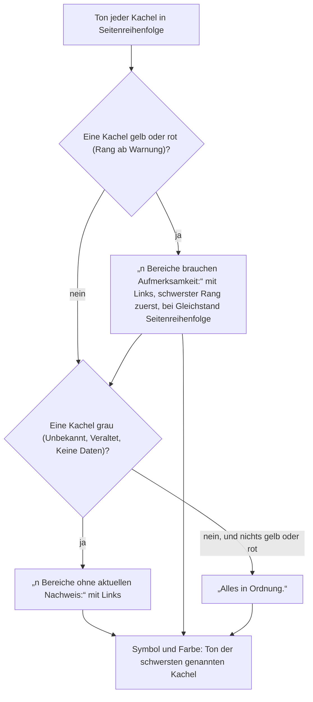

Ein abgeschalteter Bereich (Active Directory „Deaktiviert“) und ein laufender Auftrag zählen als in Ordnung.

### Fazitzeile, Zeiten und laufende Läufe

Jeder Abschnitt beginnt unter seiner Überschrift mit einer Fazitzeile (`system_status_verdict()`, `lib/system_status_verdict.php`, SY3), die die Frage „Muss ich etwas tun?“ beantwortet. Sie liest denselben Ton wie die Kachel des Bereichs und ordnet ihn mit derselben Funktion ein wie die Kopfzeile (`system_status_tone_need()`); MECM hat je eine Zeile für Datenfluss und Standort. Nennt der Abschnitt einen nächsten Schritt für genau diesen Zustand, steht er in der Zeile (Bereitstellungsdienst); sonst verweist sie auf den Hinweis beim betroffenen Eintrag. `SystemStatusCardContentsTest` leitet die Bereiche aus der Kartenliste ab und prüft, dass jeder Abschnitt eine Fazitzeile rendert.

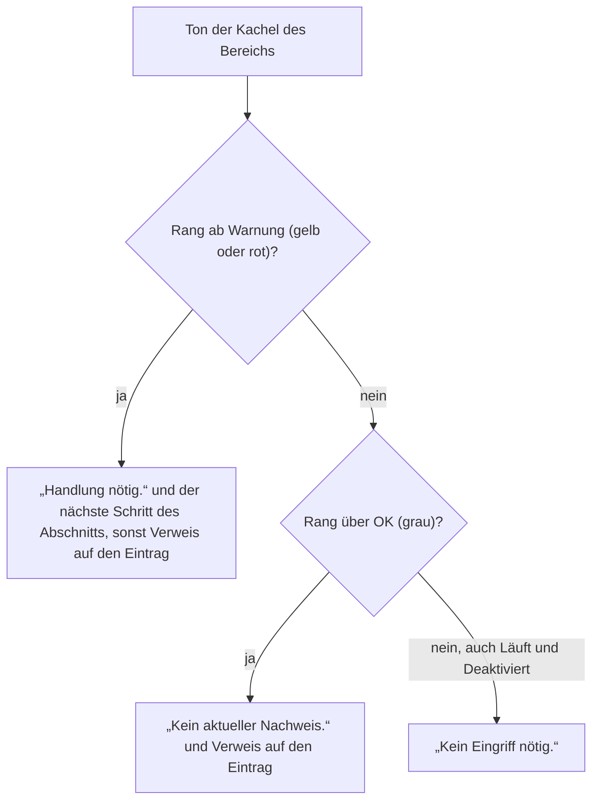

Zeiten stehen in den Faktenlisten relativ und absolut in einem `<time datetime>` (`portal_time_html()`, `lib/portal_time_display.php`): „vor 3 Minuten (09.11.2026 14:02:05)“, der absolute Teil im Format von `portal_format_timestamp()`. Der relative Teil bezieht sich auf den Stand der Anzeige im Seitenkopf und entfällt ab `VIRTUSPHERE_TIME_RELATIVE_MAX_SECONDS`. Dauern stehen in höchstens zwei Einheiten, die größte zuerst (`portal_format_duration()`: „8 Minuten 15 Sekunden“, „1 Stunde 2 Minuten“).

## Bereitstellungsdienst

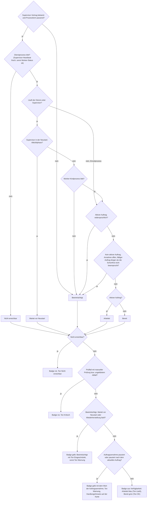

Die Schonfrist für einen nicht beanspruchten Auftrag ist `VIRTUSPHERE_DEPLOY_CLAIM_GRACE_SECONDS`. Ist die Annahme pausiert, sagt die Karte das ausdrücklich, statt einen Rückstand zu melden. Die Verfügbarkeit bleibt bei einer Pause unverändert, die Überblickskarte aber nicht: Ton (`deploy_service_badge_tone()`, die Farbe `deploy_service_badge_variant()` folgt daraus) und Wort (`deploy_service_summary_label()`) folgen derselben Rangfolge wie im Diagramm, und eine Pause heißt dort wie die Achse Auftragsannahme der Karte („Nimmt keine Aufträge an“ oder „Pausiert nach dem aktuellen Auftrag“). Unter den Achsen steht dann ein Satz, was die Pause kostet und wie sie endet (`deploy_service_claim_hint()`). Auf der Karte tragen alle drei Achsen ihr eigenes Wort mit dem Symbol ihres Tons; die Normalwerte „Nimmt Aufträge an“ und „Keine offene Klärung“ sind grün, nicht grau, denn grau heißt „kein Nachweis“.

Die Fazitzeile der Karte nennt den nächsten Schritt in derselben Rangfolge (`deploy_service_verdict_action()`, `lib/system_status_service_verdict.php`). Bis SY3 hatten „Nicht erreichbar“ und „Wartet vor Neustart“ keinen. Ein Satz, den die Fazitzeile schon trägt, steht nicht noch einmal darunter; ein zweiter Grund (nicht erreichbar und pausiert) behält seine eigene Zeile (R39). Die Lebenszeichen-Zeile „Bereitstellungsdienst (Portal)“ unter „Interne Dienste“ verweist auf diese Karte, statt einen zweiten Reparaturhinweis zu zeigen.

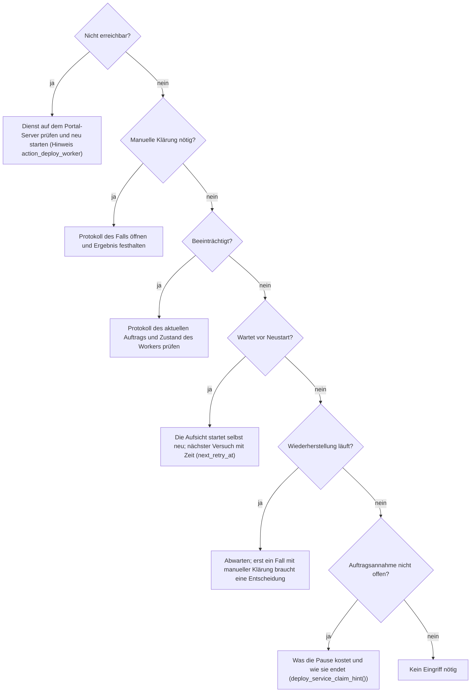

Der Dashboard-Hinweis nennt nur die Teile, die nicht in Ordnung sind (`deploy_service_attention_parts()`): eine beeinträchtigte oder nicht erreichbare Verfügbarkeit, eine nicht offene Auftragsannahme, eine offene Klärung. „Bereit“ oder „Keine offene Klärung“ stehen dort nicht mehr.

## Active Directory

Erscheint nur, wenn eine LDAPS-Konfiguration gespeichert ist, und nur für Benutzer mit dem Recht **Benutzerkonten verwalten** (`users.manage`): Die Controller-Namen sind interne Infrastruktur.

Nutzbar ist ein Controller, der aktiv ist und für den aktuellen Konfigurationsstand getestet wurde. Jede echte Anmeldung, jede Sitzungsprüfung und jeder Test schreibt eine Beobachtung; automatische Fehlschläge nehmen die Zulassung nicht zurück, nur ein fehlgeschlagener manueller Test tut das.

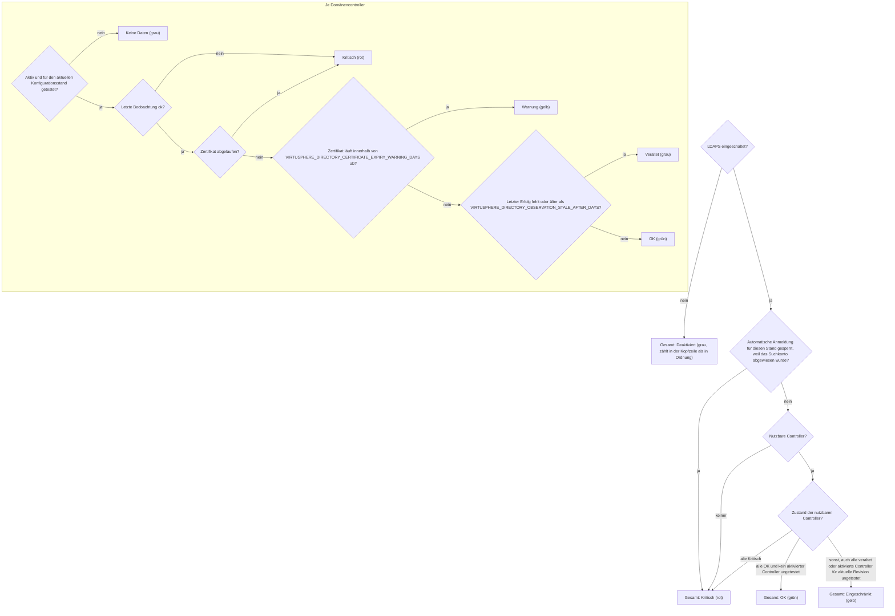

Das Zertifikat kennt die Seite nur aus dem letzten manuellen Test. Ein unlesbares Ablaufdatum überspringt die beiden Zertifikatsfragen. Aktivierte Controller ohne Test für die aktuelle Revision fehlen im zugelassenen Pool und verhindern eine grüne Gesamtampel. Die Speichermeldung nennt ihre Anzahl.

## MECM

Die drei Sync-Aufgaben (Devices Sync, Packages Sync, Package Import) und der Site-Health-Reporter melden jeden Lauf an `mecm_report.php?action=reportRun`. Sync und Site werden getrennt bewertet: Ein kritischer Site-Zustand beweist keinen ausgefallenen Datenfluss, und ein ausgefallener Sync behauptet nicht, MECM selbst sei kritisch. Die Kachel zeigt deshalb zwei Zeilen, „Datenfluss“ (schlechteste Sync-Zeile) und „Standort“ (Site-Bewertung), wie die Dashboard-Kachel (`system_status_mecm_overview_badge()`); nur die Kopfzeile nimmt die schlechtere der beiden (`system_status_mecm_overview_tone()`).

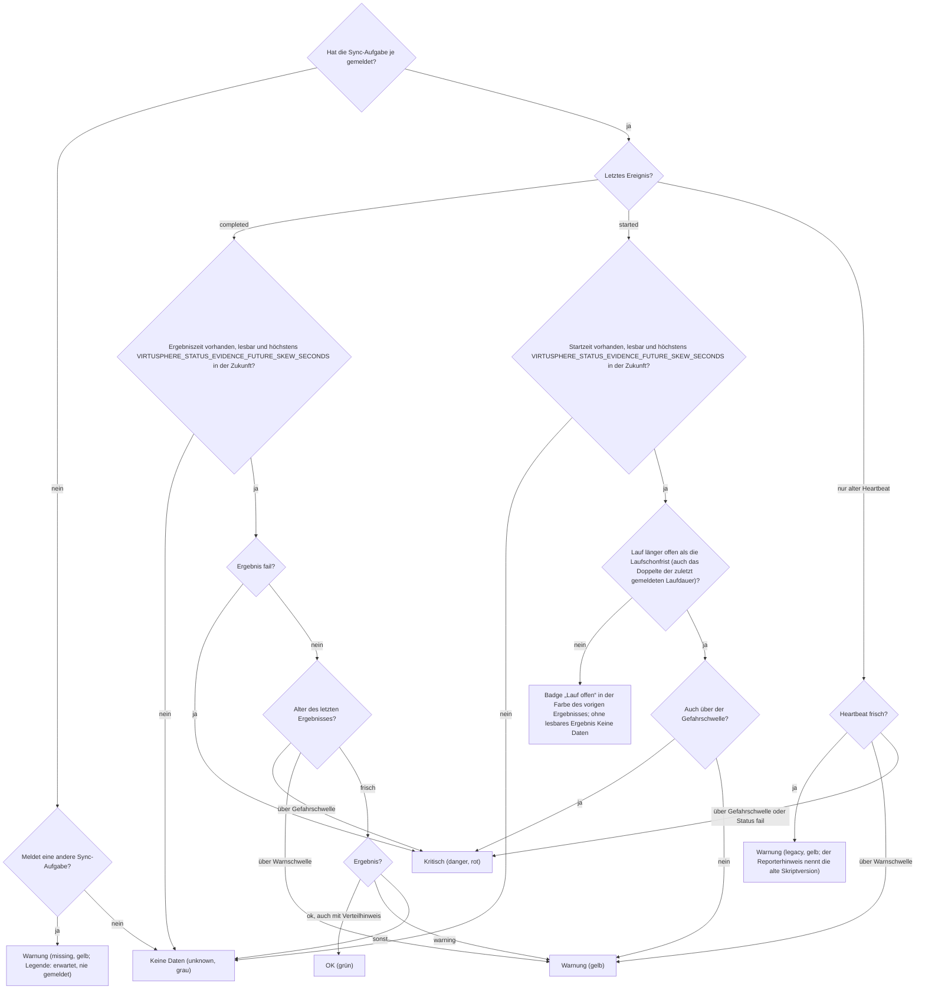

Verteilhinweise des Package Import (`package_content_failed`, `package_content_in_progress`) erscheinen auf der Karte, ändern aber das Ergebnis nicht: Die Verteilung an die DPs ist Sache von MECM (AV2), ein Lauf mit nur solchen Hinweisen bleibt grün.

Die Karte des Package Import (SY3) beginnt mit ihrer Fazitzeile, die Scan und Verteilung getrennt nennt („Letzter Scan ohne offene Punkte. 12 Verteilhinweise an Distribution Points (DP); sie blockieren nichts.“, `system_status_autoimporter_fact()`). Ein laufender Lauf steht in einer eigenen Zeile „Läuft seit … (letzter Lauf …)“ (`system_status_run_running_line()`, für alle drei Sync-Aufgaben); das Ergebnis darunter bleibt das des letzten Abschlusses. Der Hinweis „Länger als üblich“ erscheint erst, wenn der Lauf seine Laufschonfrist überschreitet (`virtusphere_run_report_overdue()`), und nennt sie. Die Zähler sagen, was sie zählen („Bearbeitete Paketordner“, „Neue Anwendungen“); `unchanged` ist kein Zähler, sondern „Lauf ohne Änderung: Ja/Nein“. Offene Punkte und Verteilhinweise nennen die Zahl der Pakete, mit Rest „mindestens“; Verteilhinweise stehen als Information, nicht im Stil eines Handlungshinweises.

Die Technischen Details des Package Import sind eine Tabelle je Ursache (`system_status_render_autoimporter_details()`, `lib/system_status_autoimporter_panels.php`). Sie liest die feste Grammatik des Reporters (`Format-VsRunDetail`, `Add-VsRunCause`, AR1) und verändert sie nicht:

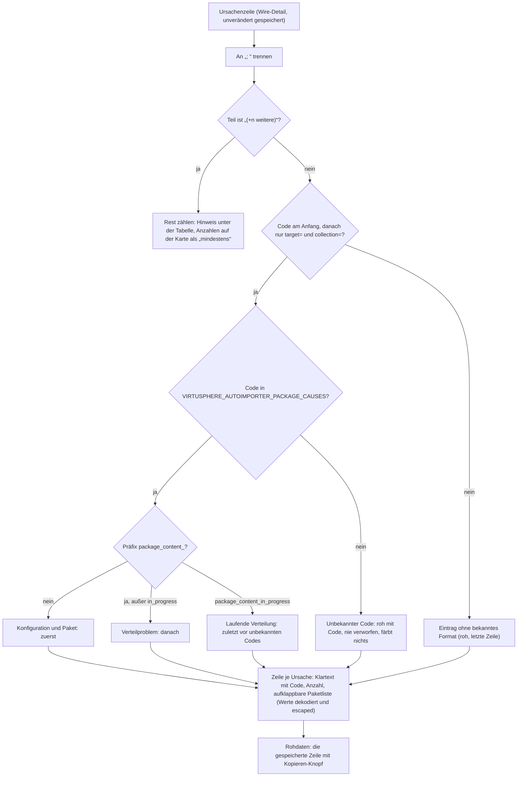

Der Site-Health-Reporter wird eigens bewertet: Ein überfälliger Bericht färbt den Reporter gelb („Warnung“, Melderzeile). Der letzte Site-Befund bleibt getrennt sichtbar, grau als „Veraltet“ und historisch markiert. Sein Alter behauptet keinen aktuellen kritischen MECM-Zustand. Dashboard und Systemstatus lesen beide Achsen aus demselben Snapshot. Der Standortzustand nutzt die fünf Wörter des fachlichen Zustands (OK, Warnung, Eingeschränkt, Kritisch, Unbekannt), nie ein Melderwort wie „Nicht erreichbar“. Bei MECM-kritisch ordnet das Portal die gemeldeten Rollen und Komponenten je Typ über die Tabelle in `lib/mecm_site_assessment.php` ein (ADR-0018 Amendment 2026-11-09). Die Einordnungstabelle mit Quellen und die MECM-Schwellen (Fehlermeldungen seit Mitternacht) stehen in `mecm-integration.md`, Abschnitte „Wie MECM den Standort rot färbt“ und „Einordnung der Rollen und Komponenten“.

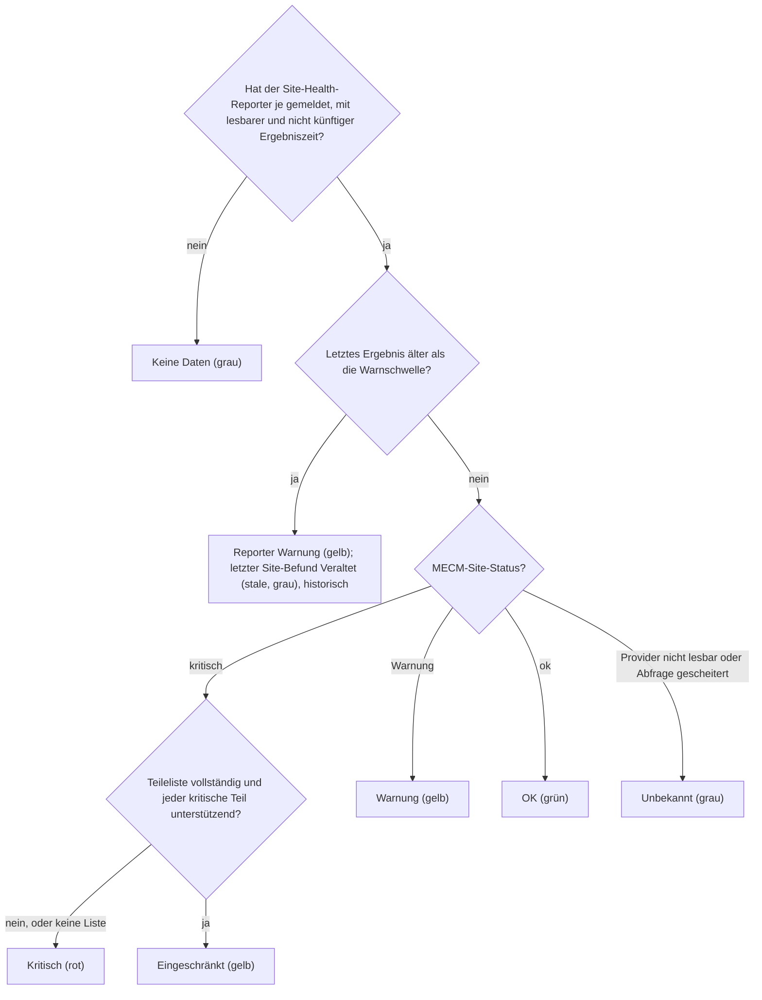

Schwellen: Die Warnschwelle liegt bei `VIRTUSPHERE_HEARTBEAT_WARN_MULTIPLIER` Intervallen, mindestens `VIRTUSPHERE_HEARTBEAT_WARN_FLOOR_SECONDS`; die Gefahrschwelle bei `VIRTUSPHERE_HEARTBEAT_DANGER_MULTIPLIER` Intervallen, mindestens `VIRTUSPHERE_HEARTBEAT_DANGER_FLOOR_SECONDS`; die Laufschonfrist eines offenen Laufs ist der größte Wert aus Warnschwelle, `VIRTUSPHERE_RUN_GRACE_SECONDS` und dem `VIRTUSPHERE_RUN_DURATION_GRACE_FACTOR`-fachen der Dauer, die der Reporter mit seinem letzten Abschluss gemeldet hat (dieser Anteil höchstens `VIRTUSPHERE_RUN_DURATION_GRACE_MAX_SECONDS`). Ein langer Autoimporter-Scan bleibt so in der Farbe des vorigen Ergebnisses, statt nach 10 Minuten rot und beim Abschluss wieder gelb zu werden; ein Lauf, der deutlich länger braucht als der letzte, wird weiterhin rot. Seit AL1 hasht der Autoimporter nur neue oder geänderte Dateien, ruhige Läufe sind daher kurz. Der erste Lauf nach einem Neustart der Aufgabe hasht dagegen den ganzen Baum und kann bei vielen großen Installern die feste Frist überschreiten; die Karte zeigt ihn dann bis zum Abschluss als verspätet. Dasselbe gilt für einen langen Vollscan nach kurzen ruhigen Läufen, weil die Schonfrist an der zuletzt gemeldeten Dauer hängt (AR1-Folgepunkt, in SY3 geprüft und offen gelassen: Die Statuszeile speichert nur die letzte Dauer, eine längste jüngere Scandauer bräuchte Laufhistorie oder ein Reporterfeld). Ohne gemeldete Dauer (erster Lauf, Legacy-Vorgeschichte) gelten nur die festen Werte. Erst nach ihr wird ein offener Lauf bewertet, und die Gefahrschwelle entscheidet zwischen Warnung und Kritisch. Liegt die Gefahrschwelle unter der Laufschonfrist, wie bei kurzen Takten, springt ein hängender Lauf nach der Schonfrist sofort auf Rot. Über den Zeilen stehen zwei Hinweise, die keine Ampel färben: abgewiesene Maschinenzugriffe des letzten Tages mit IP, und frische Meldungen von mehr als einer IP-Adresse.

## Ansible-Test

Nachweis ist der Volltest je Ansible-Zugang. Er läuft über **Volltest jetzt starten**, über **Verbindung und Umgebung prüfen** (Zugangsdaten) oder geplant als Kindprozess des Deploy-Workers. Der letzte tatsächlich bearbeitete Missionsauftrag steht daneben, färbt die Ampel aber nicht.

Ein bestandener Volltest, manuell oder geplant, räumt danach liegengebliebene ESXi-Zugangsdateien dieses Ziels auf, soweit der Zugang noch darauf zeigt. Das Zeitbudget beträgt 60 Sekunden; bricht das Aufräumen ab, bleibt der Rest für den nächsten Kontakt, und die Meldung sagt es. Das Ergebnis des Tests ändert der Aufräumlauf nicht. Fehlt der Aufräum-Timer auf dem Ansible-Host, nennt die Meldung ihn als Hinweis, ohne die Ampel zu verändern.

Die getrennte Hostidentitätsanzeige zeigt Pin, Bestätigung und zuletzt beobachtete Abweichung. Sie ist kein Volltest und färbt dessen vorhandenen Nachweis nicht um. Jede SSH-/SFTP-Anmeldung geht über den [gemeinsamen Vertrauensablauf](trust-flows.md#ssh-und-sftp-zum-ubuntu-host); das gilt auch für die SFTP-Probe nach bestandenem SSH-Preflight.

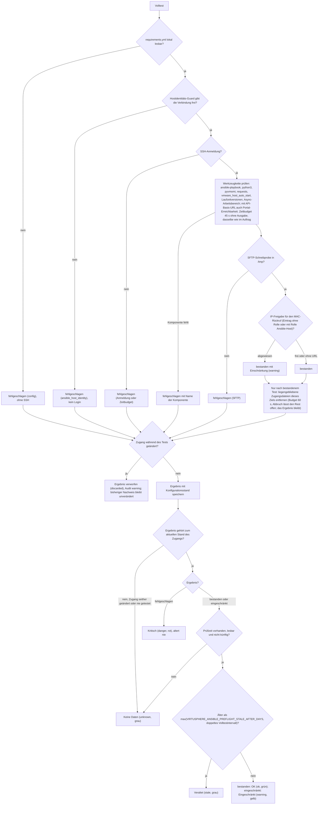

Die Deploy-Seite übernimmt die Ansible-Volltest-Ampel und den Prüfzeitpunkt aus `integration_health_snapshot()`. Der gewählte Zugang zeigt dieselbe Evidenz wie seine Systemstatus-Karte; ohne JavaScript bleiben die beschrifteten Nachweise aller Zugänge sichtbar. Der Hinweis sperrt keinen Auftrag. Seine Karte bietet berechtigten Benutzern **Volltest jetzt starten**.

## ESXi-Inventar

Nachweis ist der Inventarabruf je ESXi-Zugang, ein Systemauftrag des Deploy-Workers. Er läuft im eingestellten Intervall, manuell über **Alle aktualisieren** oder den Einzelabruf, beim Speichern und Testen eines ESXi-Zugangs und nach jedem Endzustand eines `create`- oder `full`-Auftrags, sobald eine Create-Einheit ihre Ansible-Job-ID dauerhaft gespeichert hat. Der Abruf ist fail-soft und wird durch den vorhandenen Systemauftrag-Writer dedupliziert.

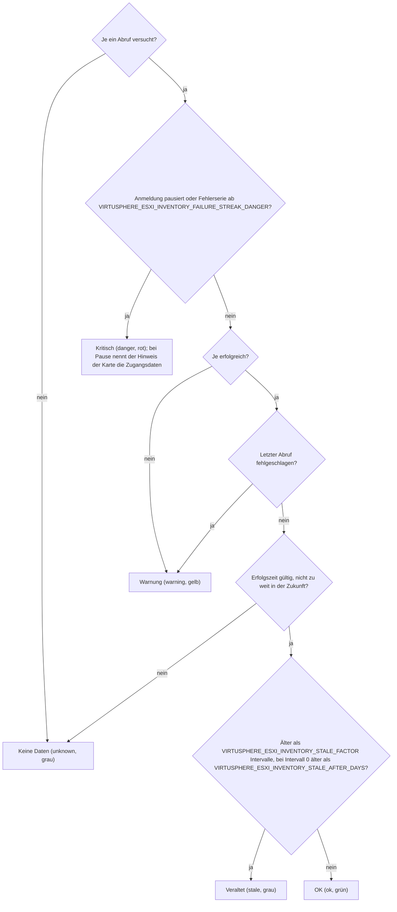

Host-Eigenschaften aus einem erfolgreichen Abruf färben die Ampel nicht, sondern erscheinen als eigene Badges: freie Lizenz, HA-Cluster, Wartungsmodus. Über den Karten nennt eine Zeile, warum kein automatischer Abruf läuft: Intervall 0, kein Ansible-Zugang für den Abruf, Deploy-Worker nicht aktiv oder Anmeldung pausiert. Wiederholte Links und Knöpfe jeder Zugangskarte (Inventardetails, Abruf, Auftragsprotokolle) tragen den Namen des Zugangs als nur vorgelesenen Zusatz, damit die Linkliste eines Screenreaders sie unterscheidet.

## Abweichungen

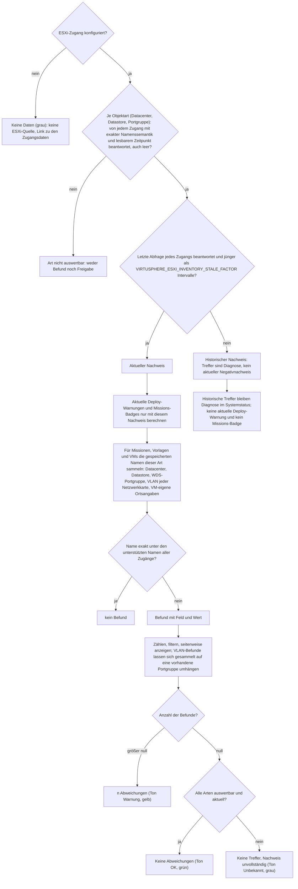

Karte und Abschnittsüberschrift rendern dieselbe Zahl mit demselben Badge (`deviation_count_badge()`, Ton `deviation_count_tone()`), die Vollständigkeit liest beide aus `system_status_deviation_evidence_current()`. Das Wort „Abweichung“ steht nur hier; eine falsche Prüfsumme im Bereich Host und Backup heißt „Kritisch“. Verglichen wird exakt, auch in der Groß- und Kleinschreibung. Ist keine Art auswertbar, zeigt der Bereich keine Zahl, sondern einen Hinweis mit Link zum ESXi-Inventar. Mit Inventarintervall 0 entfällt die Altersgrenze. Deploy-Missionswarnung und Missionslisten-Badge verwenden denselben Bericht und zeigen nur aktuelle Treffer für Arten mit Namenssemantik v2. Die Host-Warnung vergleicht dieselbe Art für den gewählten Host und mindestens einen anderen Host; beide Nachweise müssen aktuell sein. Historische Treffer bleiben Diagnose im Systemstatus und erscheinen nicht als aktuelle Warnung. Die Host-Warnung nennt nur Werte, die auf einem anderen aktuellen Host vorhanden sind; ein Wert, der auf keinem aktuellen Host vorkommt, bleibt ausschließlich in der Missionswarnung.

## Host und Backup

Eigener Bereich mit eigener Kachel (`lib/system_status_backup_panels.php`, Anker `host-backup`). Bis SY1 stand er als Block „Hostzustand“ ohne Kachel unter „Interne Dienste“, und ein fehlgeschlagenes Backup ließ die Übersicht grün. Die Zeilen haben je einen eigenen Ton; die Kachel zeigt den schlechtesten davon (`system_status_host_overview_tone()` über `system_status_host_checks()`, dieselbe Liste, aus der der Abschnitt seine Zeilen rendert). Der Bereich ändert weder die Ampel „Interne Dienste“ noch den Dashboard-Hinweis oder `health.php`.

Quelle ist der Backup-Statuskanal (`docs/operations/backup.md`), auf der Seite einmal je Aufruf gelesen (`system_status_backup_panel_data()`): Backup aus `backup_status_read()` mit den Zuständen der Backup-Karte (`backup_status_tone()`, dieselbe Zuordnung wie in den Einstellungen), Restore-Test aus `backup_drill_status_read()` (schreibt der Drill `scripts/restore_test.sh` selbst), Prüfsummen aus `backup_scrub_status_read()` (schreibt `scripts/backup-scrub.sh`). Die Zertifikatszeile erscheint nur, solange `https_listener_live()` gilt, und zählt nur dann für die Kachel. Die Zeile „Backup-Verschlüsselung“ erscheint nur bei einem Befund von `backup_encryption_finding()` (kein Zertifikat hinterlegt oder letzter erfolgreicher Lauf nicht an das hinterlegte verschlüsselt), aus demselben gelesenen Backup-Status, und färbt die Kachel gelb (SY3; vorher ein Hinweis über der Übersicht). Ein fehlender, unlesbarer oder in der Zukunft datierter Nachweis heißt „Keine Daten“, nie „OK“.

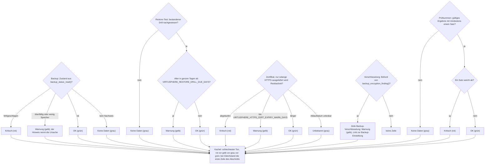

## Interne Dienste

Wartungsdienst und Deploy-Worker schreiben ihren Status direkt in dieselbe Tabelle wie die MECM-Aufgaben, im Takt `VIRTUSPHERE_MAINTENANCE_HEARTBEAT_INTERVAL_SECONDS` beziehungsweise `VIRTUSPHERE_DEPLOY_WORKER_HEARTBEAT_INTERVAL_SECONDS`. Ihre Zeilen sind reine Lebenszeichen und sprechen deshalb Melderwörter (`heartbeat_badge($state, 'liveness')`): Die Zeile des Bereitstellungsdienstes sagt „Aktuell“ neben der Karte „Bereit“, statt ein zweites Wort für den Zustand des Dienstes zu behaupten. Seit SY3 trägt sie keinen eigenen Reparaturhinweis mehr, sondern verweist auf die Karte Bereitstellungsdienst, deren Fazitzeile den Schritt nennt; sie bleibt, weil die Kachel „Interne Dienste“ sie mitzählt.

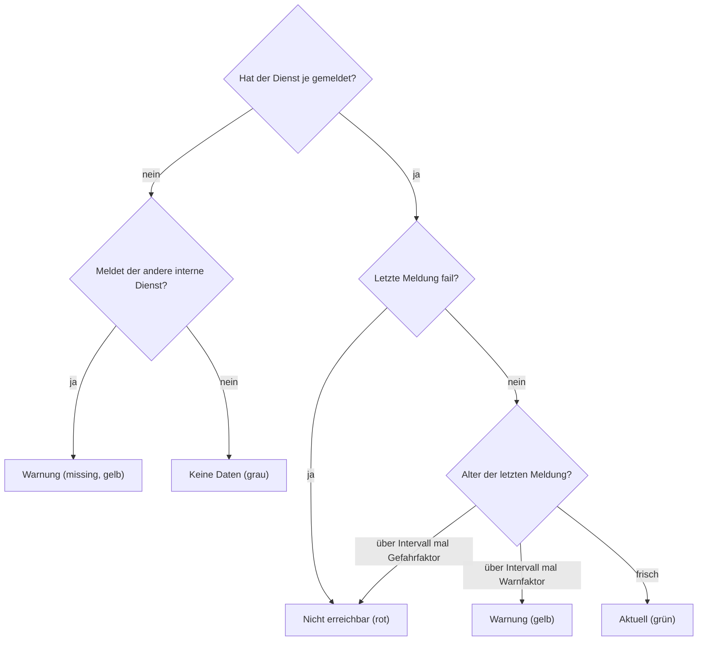
