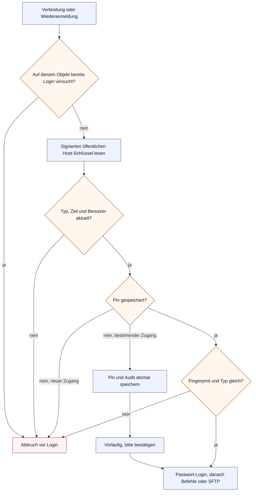

# Verbindungen und Vertrauensanker

Der [Ablauf-Einstieg](flows.md) verlinkt die übrigen Abläufe und erklärt die gemeinsame Legende. Dieser Abschnitt beschreibt ausschließlich die Hostidentität zwischen PHP/Worker und dem Ubuntu-Ansible-Host. ESXi-Zertifikatsvertrauen bleibt im [ESXi-Inventar](esxi-inventory.md), die übrigen Übergaben in der [Bereitstellungskette](deploy-chain.md).

## SSH und SFTP zum Ubuntu-Host

Zweck: Ein Passwort oder eine Datei mit ESXi-Zugangsdaten darf erst nach Prüfung des SSH-Host-Schlüssels an den Ubuntu-Host gehen.



| Zugang | Zulässige Verbindung | Bestätigung |
|---|---|---|
| Neu, ohne Pin | Nur Handshake zur Anzeige von Fingerprint und Typ; kein Login | Admin vergleicht unabhängig auf dem Host und bestätigt ausdrücklich |
| Typ, Host oder Port geändert | Pin, Beobachtung, Bestätigung und Upgrade-Ausnahme zurückgesetzt; kein Login | Das neue Ziel unabhängig prüfen und ausdrücklich bestätigen |
| Bestehend nach Upgrade, noch ohne Pin | Erste Beobachtung wird vor Login atomar samt Audit angeheftet | Bis zur Bestätigung steht „vorläufig angeheftet, bitte bestätigen“ |
| Vorläufig oder bestätigt, gleicher Schlüssel | Login erlaubt | Bestätigung eines unveränderten Pins entwertet den bisherigen Volltest nicht |
| Vorläufig oder bestätigt, anderer Schlüssel | Vor Login gesperrt; Beobachtung sichtbar, Pin bleibt erhalten | Einen legitimen Wechsel unabhängig prüfen und ausdrücklich bestätigen |
| Wiederanmeldung auf demselben Verbindungsobjekt | Vor Login gesperrt, weil phpseclib die Signaturprüfung auf diesem Objekt zwischenspeichert | Jeder externe Verbindungsaufbau verwendet ein frisches Guard-Objekt; kein automatischer Wiederholungsversuch |

### Wenn etwas schiefgeht

Ein fehlender/unprüfbarer Schlüssel, ein veralteter Zugangssnapshot oder eine fehlgeschlagene dauerhafte Speicherung führt vor der Passwortübertragung zum Abbruch. Bei einem abweichenden Schlüssel bleibt der gespeicherte Pin stehen; die beobachtete Abweichung erscheint in Zugangsdaten und Systemstatus. Der Auftrag protokolliert die geschlossene Hostidentitätsursache. Zwei erste Verbindungen werden am selben Zugangsdatensatz serialisiert; nur der erste Schlüssel wird angeheftet.

Dieser Vertrauenscheck schreibt selbst keinen VM-, Auftrags- oder MECM-Zustand. Die vorhandenen Worker-Fehlerwege entscheiden den Auftrags- und VM-Endzustand; der [Worker-Ablauf](deploy-flows.md#worker-ein-auftrag) beschreibt, dass der Host-Preflight vor der Markierung `deploying` läuft: Ein Abbruch durch die Hostidentität vor dieser Markierung lässt alle VM-Zustände unverändert. Nach der Markierung garantiert dieser Check keine Wiederherstellung eines VM-Vorzustands nach einem Auftragsfehler. Bei einem Zugangstest ändern sich nur das getrennte Testresultat und die Hostbeobachtung.

### Im Code

- `lib/ssh_host_identity.php`: `ssh_host_identity()`, `ssh_verified_login()`, gemeinsame Guard-Trait für SSH und SFTP. Der Guard greift auch bei phpseclibs interner Wiederanmeldung.
- `lib/repo/credential_host_identity.php`: aktueller Typ, Endpunkt und Benutzer; atomare erste Anheftung, unveränderlicher Pin bei Abweichung und ausdrückliche Bestätigung mit alter Revision und altem Pin.
- `lib/migrations/0059_ansible_host_identity.php`: Upgrade-Berechtigung einmalig für bestehende Zugänge; Frischschema und neue Zugänge haben sie nicht.
- `lib/credentials_host_identity.php`: gemeinsame Anzeige und bestätigtes Formular; Portal-POST mit `credentials.manage`, CSRF und der gemeinsamen Bestätigungsmodalität.

### Prüfung

`SshHostKeyTest`, `AnsibleHostIdentityIntegrationTest` und `SshHostIdentityContractTest`; für die Typableitung, die Abweichung als zweiter Schritt und die Zeile mit Anker `AnsibleHostKeyFormatTest`, `CredentialHostIdentityRenderTest` und `HostIdentityToolContractTest` (Werkzeug auf dem Ansible-Host): keine Anmeldung bei Abweichung, kein Geheimnistransfer bei fehlender Speicherung, Erst-Anheften und spätere Abweichung, neue Zugänge, Bestätigung, veraltete Formulare und Zugangssnapshots, Wiederanmeldung und Transportabdeckung. Die Laborprobe LP-09 benötigt einen vom Nutzer betriebenen Testhost; der synthetische QA-Stack enthält keinen SSH-Server.

### Betrieb

In **Zugangsdaten** den Ansible-Zugang testen und den Fingerprint auf dem Ubuntu-Host unabhängig vergleichen. Die Zeile **Host-Schlüssel** steht über die volle Breite unter dem Zugang, mit dem Anker `credentials.php#host-identity-<id>`; der Link „Zugangsdaten: Host-Schlüssel prüfen“ im Systemstatus führt dorthin. Die Zeile ist offen, solange etwas zu tun ist (vorläufig, unbestätigt oder abweichend), sonst zu; ihr Knopf heißt dann **Host-Schlüssel ändern**. Die Zeile **Bearbeiten** darunter ändert den Zugang und ist nicht die Bestätigung. Die Befehle je Schlüsseltyp stehen in der Zeile zum Kopieren bereit. Beispiel für ED25519; die ausgegebene Zeile nennt Fingerprint und Typ und gehört unverändert in das Feld:

```sh
ssh-keygen -l -E sha256 -f /etc/ssh/ssh_host_ed25519_key.pub
```

Für ECDSA-Schlüssel gilt `ssh_host_ecdsa_key.pub`, für RSA `ssh_host_rsa_key.pub`; die Zeile **Host-Schlüssel** zeigt den Befehl für jeden Typ. Das Feld **SHA256-Fingerprint oder ganze ssh-keygen-Zeile** nimmt beide Formen an: den Wert allein oder die ganze Zeile `256 SHA256:… root@host (ED25519)`. Den Schlüsseltyp übernimmt VirtuSphere aus der Zeile oder aus dem beobachteten Schlüssel, zu dem der Fingerprint passt. Ein Feld für den Typ erscheint nur, solange für den Zugang noch kein Schlüssel beobachtet oder angeheftet ist (Vorab-Anheften); es bietet die OpenSSH-Namen `ssh-ed25519`, `ecdsa-sha2-nistp256`, `ecdsa-sha2-nistp384`, `ecdsa-sha2-nistp521` und `ssh-rsa` an, **nicht** die Kurzform `ED25519` aus der Klammer der `ssh-keygen`-Ausgabe. Das Portal speichert den Typ als Teil des Pins und vergleicht ihn bei jeder Anmeldung mit dem Host; ein anders geschriebener Typ sperrt die Anmeldung („Host-Schlüssel weicht ab“), obwohl der Fingerprint stimmt. Passt der Wert weder zum beobachteten noch zum angehefteten Schlüssel, verlangt das Portal die ganze Zeile, weil nur sie den Typ nennt.

Eine Abweichung vom angehefteten oder beobachteten Schlüssel wird nicht sofort gespeichert. Das Portal zeigt beide Werte und die Folge: Die Anmeldung bleibt gesperrt, bis der Host diesen Schlüssel zeigt, und ein bisheriger Volltest wird verworfen. Erst der Knopf **Pin ersetzen** schreibt sie; ohne angehefteten Schlüssel heißt er **Trotzdem bestätigen**. Eine bestätigte Zeile zeigt, ob der Host seit der Bestätigung passend geantwortet hat (**zuletzt passend gesehen am …**) oder ob seither keine Verbindung lief. Bei einem legitimen Schlüsselwechsel bleibt der Zugang bis zur ausdrücklichen Bestätigung gesperrt. Ein falscher Schlüssel während der ersten Verbindung nach dem Upgrade kann vorläufig angeheftet werden; nur der unabhängige Vergleich deckt dieses verbleibende Erstkontakt-Risiko auf.

Ohne Abtippen geht es auch über das Werkzeug `Ansible/host-identity/virtusphere-host-identity.sh` (im Offline-Paket unter `virtusphere/Ansible/host-identity/`). Auf dem Ansible-Host gibt `sh virtusphere-host-identity.sh` je öffentlichem Host-Schlüssel die Zeile aus, die das Feld akzeptiert; sie wird kopiert, nicht übertragen. Das Werkzeug liest nur `/etc/ssh/ssh_host_*_key.pub`, nie die privaten Schlüssel, schreibt nichts und braucht kein Netz und keine Root-Rechte. Die Bestätigung bleibt ein eigener Schritt im Portal. SSH-Kennwörter oder private Schlüssel werden dafür nicht benötigt. Details: [ADR-0045](../adr/ADR-0045-ansible-host-identity.md), Portalhilfe **Zugangsdaten**.
