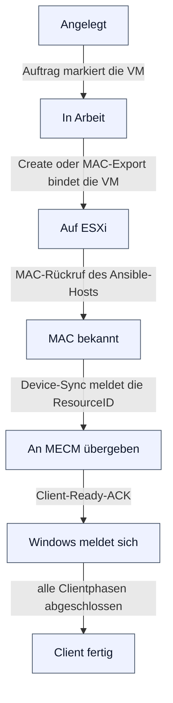
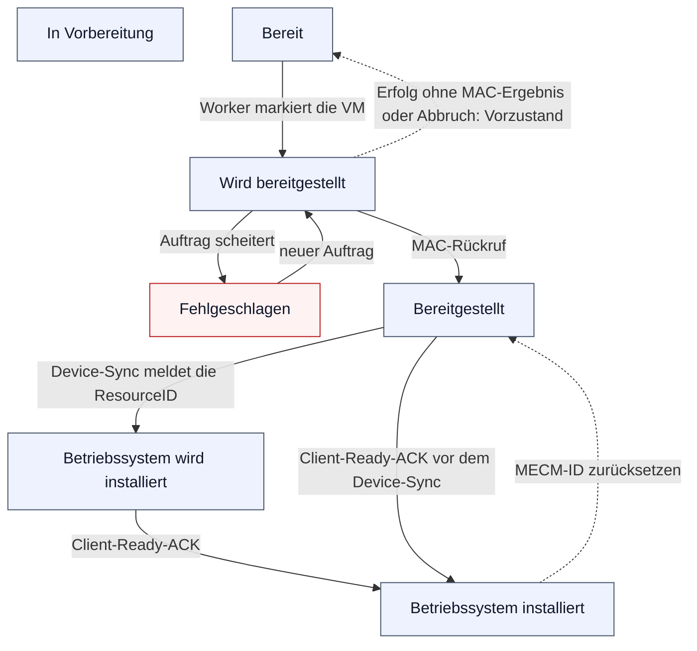
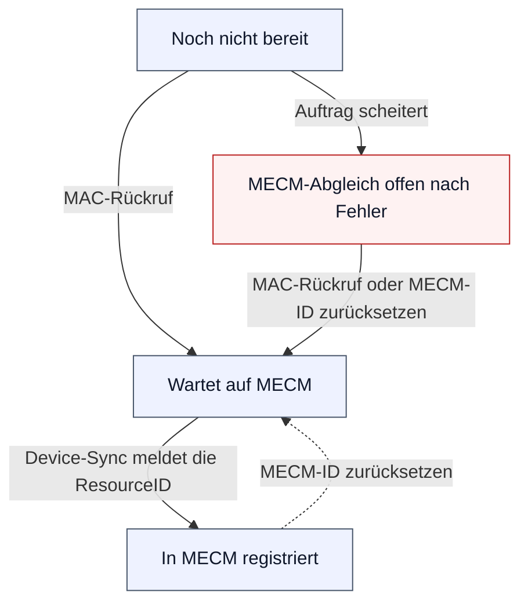

# Lebenszyklus einer VM

Eine VM trägt drei gespeicherte Werte: den Lebenszyklus (`lifecycle_state`), den MECM-Abgleich (`mecm_sync_state`) und den Stufenwert x/5 (`vm_status`), den die MECM-Schnittstelle liest. Die Phase, die VM-Liste, VM-Übersicht und VM-Editor zeigen, wird beim Lesen aus diesen Werten und weiteren Belegen abgeleitet (`Docker/WebAPI/lib/vm_phase.php`, Referenz R56 in [`docs/ai/reference/portal.md`](../ai/reference/portal.md)); sie wird nicht gespeichert und nicht übertragen. Dieses Dokument zeichnet die Phasen und die beiden Achsen mit ihren Schreibern. Die Portalhilfe zeigt denselben Weg im Abschnitt „Der Weg einer VM“ (Hilfe, Reiter Missionen). Einstieg: [Abläufe](flows.md); die Gesamtkette steht in der [Bereitstellungskette](deploy-chain.md).

## Der Weg einer VM

Eine Phase wird nur für einen Beleg vergeben, der angekommen ist (ADR-0038). Geprüft wird von der höchsten Phase abwärts; es gilt die erste, deren Regel zutrifft. Eine VM kann deshalb Phasen überspringen, etwa wenn der MAC-Export die Bindung und die MAC in einem Schritt liefert. Ein fehlgeschlagener Auftrag setzt die Phase nicht zurück; er erscheint als Befund „Auftrag fehlgeschlagen“. Vorlagen-VMs zeigen „Vorlage“ und keinen Befund, weil ihre Mission nie bereitgestellt wird.

| Nr. | Phase | Regel (erste zutreffende von oben) | Beleg und Schreiber |
|---|---|---|---|
| 7 | Client fertig | Lebenszyklus `os_installed` und jede Clientphase hat als letztes Ereignis `finished` | Clientereignisse (`Docker/WebAPI/mecm_report.php`, Aktion `reportPhase`, best effort) |
| 6 | Windows meldet sich | Lebenszyklus `os_installed` | Client-Ready-ACK (`Docker/WebAPI/mecm_client_ack.php`) |
| 5 | An MECM übergeben | Lebenszyklus `os_installing` oder MECM `registered` | Device-Sync mit ResourceID (`Docker/WebAPI/mecm_updateid.php`) |
| 4 | MAC bekannt | Lebenszyklus `deployed` oder MECM `pending` | MAC-Rückruf (`Docker/WebAPI/db_importMAC.php`) oder „MECM-ID zurücksetzen“ |
| 3 | Auf ESXi | Instanz-UUID gebunden | Create-Erfolgscommit oder MAC-Export |
| 2 | In Arbeit | Lebenszyklus `deploying` | Worker-Markierung beim Start eines Auftrags |
| 1 | Angelegt | alles andere | Anlegen, Import, Kopie aus einer Vorlage |

Die Regeln 4 bis 6 sind dieselben Prädikate, aus denen die Maschinen-API den Stufenwert berechnet (`virtusphere_legacy_status_from_states()`). Die Sortierung nach Phase rechnet dieselbe Regel in SQL (`virtusphere_vm_phase_sql()`).

## Lebenszyklus

Der Lebenszyklus wird nur vorwärts überschrieben, wenn ein Rückruf kommt: Device-Sync und Client-Ready-ACK lassen einen späteren Zustand stehen (`repo_set_vm_state_forward()`). Der Worker markiert eine VM beim Start eines Auftrags aus jedem Zustand außer `deploying`; eine VM mit ResourceID bleibt in einem Modus mit MAC-Ergebnis unmarkiert (`virtusphere_vm_is_mecm_bound()`). Was ein Auftrag angefasst hat, hält das Journal je Auftrag und VM fest (`deploy_job_vm_states`): Endet der Auftrag erfolgreich ohne MAC-Ergebnis oder wird er abgebrochen, stellt der Worker den Vorzustand wieder her; scheitert er, setzt er Lebenszyklus und MECM-Achse auf „Fehlgeschlagen“, auch bei einer VM, die er nicht markiert hat. Der Konvergenzlauf des Wartungsdienstes wendet dieselbe Regel auf eine VM an, die nach dem Ende ihres Auftrags noch `deploying` steht. `initializing` hat keinen Schreiber; der Wert bleibt im Katalog, damit ein alter Datensatz einen Namen hat.

Der MAC-Rückruf schreibt `deployed` nur für eine VM ohne ResourceID; eine schon gebundene VM behält ihren Zustand. „MECM-ID zurücksetzen“ setzt eine VM aus jedem Zustand auf `deployed` und den MECM-Abgleich auf `pending`; abgelehnt wird es für Vorlagen, bei laufendem Auftrag, ohne MAC und ohne gültigen Windows-Hostnamen.

## MECM-Abgleich

Die MECM-Achse sagt, wie weit die Übergabe an MECM ist. `registered` schreibt allein der Device-Sync; der Client-Ready-ACK lässt die Achse unverändert (VT-E1 C, ADR-0019 Amendment 4). Die Portalbeschriftung von `failed` lautet „MECM-Abgleich offen nach Fehler“, weil der Wert aus einem gescheiterten Auftrag stammt und nichts über MECM selbst sagt; ein gescheiterter Auftrag setzt ihn aus jedem Zustand der Achse.

## Stufenwert x/5

Der Stufenwert hat zwei Quellen. Gespeichert schreiben ihn nur die Schreiber in der zweiten Spalte; die Übergänge des Workers (markieren, Vorzustand, Fehler) ändern nur die beiden Achsen und lassen den gespeicherten Wert stehen. Die Maschinen-API berechnet den Wert, den der Device-Sync liest, bei jeder Abfrage aus den beiden Achsen (`Docker/WebAPI/mecm-api.php`, `virtusphere_legacy_status_from_states()`). Deshalb zeigt das Portal (Tooltip der Phase, Block „Technisch“ im VM-Editor) für eine VM in Arbeit oder nach einem Fehler den gespeicherten Wert, die Leitung dagegen 1/5.

| Stufenwert | Gespeichert von | Auf der Leitung, wenn |
|---|---|---|
| `1/5 Initializing` | nie | keine der folgenden Regeln zutrifft (Lebenszyklus `initializing`, `deploying` oder `failed` ohne MECM `pending` oder `registered`) |
| `2/5 Registered` | Anlegen, Import, Kopie aus einer Vorlage | Lebenszyklus `ready` ohne MECM `pending` oder `registered` |
| `3/5 Deployed` | MAC-Rückruf, „MECM-ID zurücksetzen“ | Lebenszyklus `deployed` oder MECM `pending` |
| `4/5 OS Installing` | Device-Sync | Lebenszyklus `os_installing` oder MECM `registered` |
| `5/5 OS Installed` | Client-Ready-ACK | Lebenszyklus `os_installed` |

Die Begriffe stehen im [Glossar](../GLOSSARY.md#vm-statusstufen).
